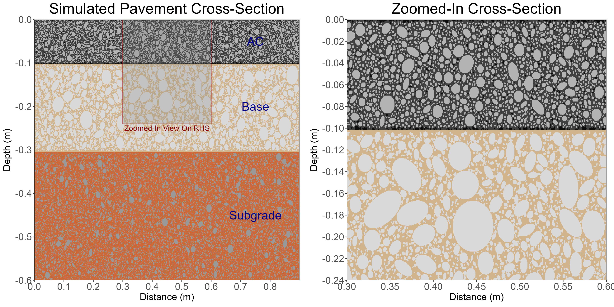
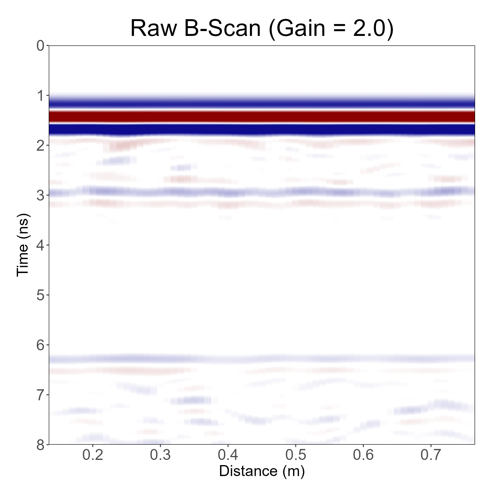
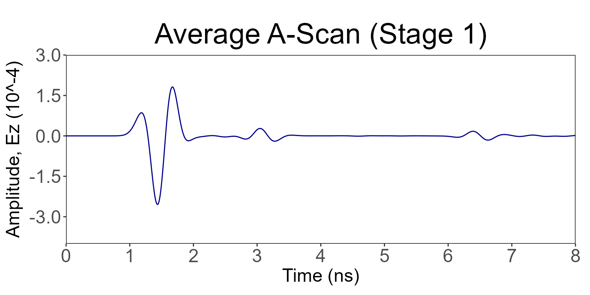
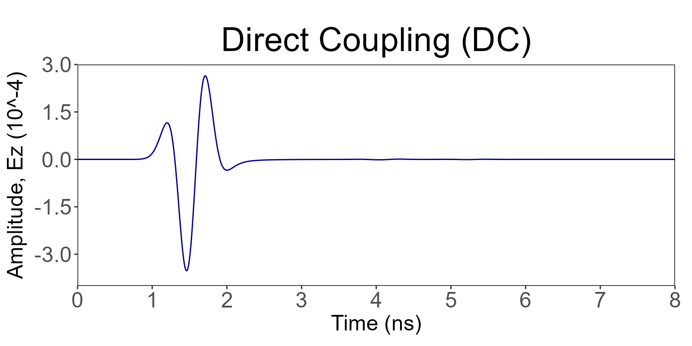
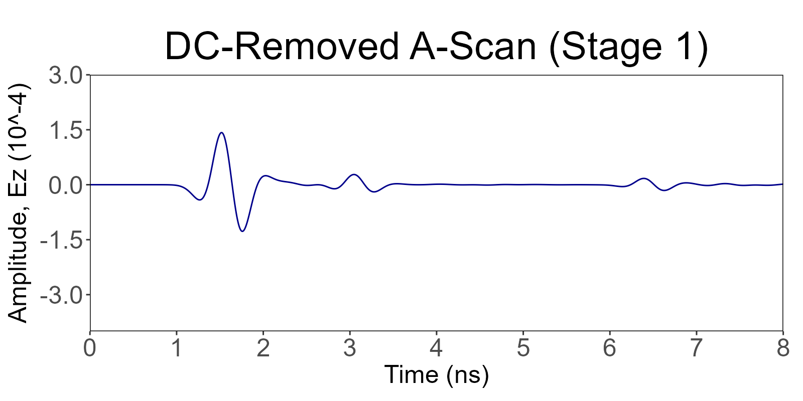
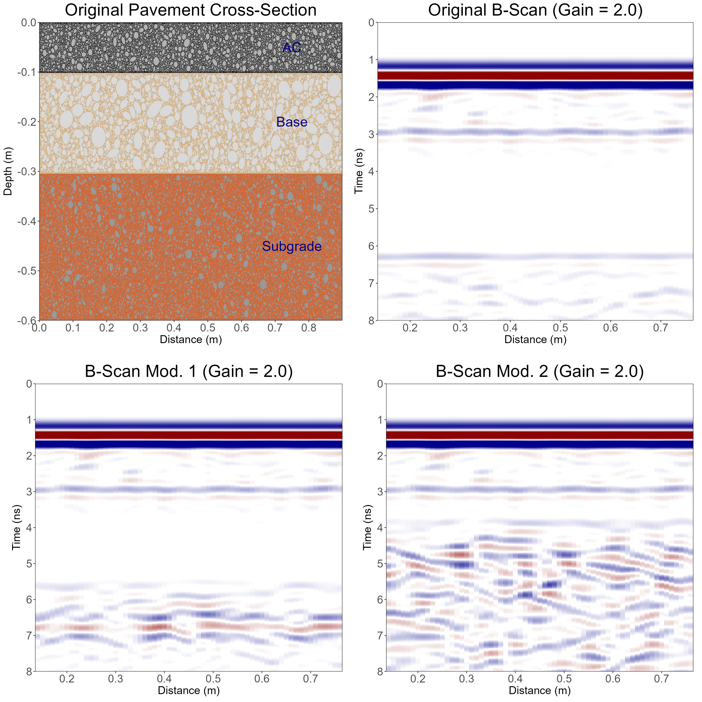
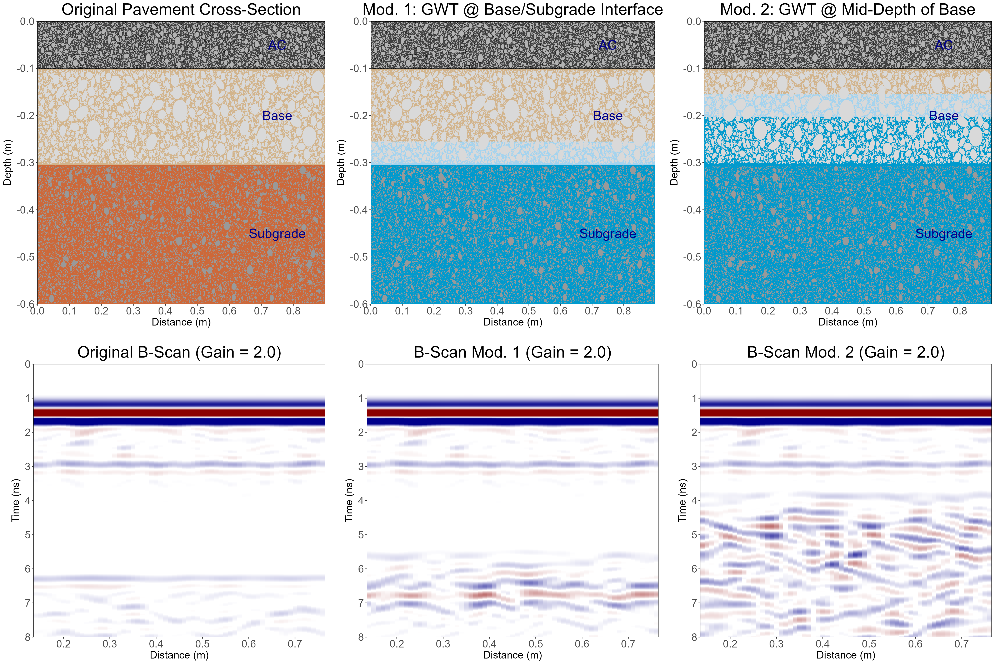

::: {.article-series-label}
**GPR Article Series · GPR-02**
:::

What changes when the pavement itself becomes part of the GPR problem?

Hyung S. Lee, Ph.D., P.E.

Similar to my previous article ([GPR-01](https://leehyu20.github.io/hyung-s-lee/posts/gpr-virtual-laboratory/)), this article grew out of a series of Ground Penetrating Radar (GPR) simulations that I originally shared through my LinkedIn posts. This is the second article in my GPR series. In my previous article, [GPR-01](https://leehyu20.github.io/hyung-s-lee/posts/gpr-virtual-laboratory/), I used a virtual GPR laboratory to examine how relatively simple geometries such as cracks, water, and voids within homogeneous layers of a pavement structure affect the simulated GPR response. This time, I wanted to see what happens when the pavement materials themselves are heterogeneous, and the GPR signal is no longer quite so easy to interpret.

# 1. Introduction

In [GPR-01](https://leehyu20.github.io/hyung-s-lee/posts/gpr-virtual-laboratory/), I built a virtual GPR laboratory and used it to explore a few fundamental questions. What happens when the interfaces between different pavement layers are uneven? What does a series of idealized cracks look like in the GPR signal? Why and how does water change the GPR response? And how does a buried void create the GPR signature (i.e., the hyperbola) in a B-scan?

The experiments in [GPR-01](https://leehyu20.github.io/hyung-s-lee/posts/gpr-virtual-laboratory/) were intentionally kept "clean". All the pavement layers, namely the asphalt, base, and subgrade, were modeled as homogeneous materials (i.e., constant dielectric and electrical conductivity for each material), making it easier to connect a simulated anomaly to its GPR response. But real pavements are never a stack of perfectly uniform or homogeneous materials. Asphalt Concrete (AC) is made up of aggregates, mastic, and air voids. Granular base may contain large particles, fines, and pores while subgrade varies from place to place, particularly as moisture changes.

[**So, I wanted to upgrade my virtual GPR laboratory and started modeling all layers of a pavement (i.e., AC, base, and subgrade) with heterogeneous materials.**]{.darkred}

As a preview of this article, Figure 1 shows an example of the heterogeneous pavement layers I used in my recent GPR experiments.

{fig-align="center" width="95%"}

::: {.text-center}
*Figure 1. Example heterogeneous pavement layers used in GPR simulations.*
:::

What do you think the GPR scans will look like? Well... In this case, each of the different particles making up a pavement layer reflects the electromagnetic energy and causes scattering of the GPR signal, even without any other anomalies. So going from GPR-01 to GPR-02, the question naturally changes from "What does this feature look like?" to "Can I still recognize an anomaly when everything around it is reflecting the GPR signal as well?"

# 2. Building a More Realistic Virtual Pavement

As you may have guessed from Figure 1, I populated the pavement model with synthetic particles and voids, rather than assigning a single dielectric constant and the corresponding electrical conductivity to each layer.

For the AC layer, the aggregate particles were generated as randomly oriented circles and ellipses. The particle size distribution generally followed the aggregate gradation of a dense-graded asphalt mixture with a Nominal Maximum Aggregate Size (NMAS) of 12.5 mm. More specifically, I specified 100% passing 19.0-mm sieve, 95% passing 12.5-mm sieve, and 43% passing 2.36-mm (No. 8) sieve. Any particles greater than 1.5 mm in size were explicitly defined in the spatial domain while those smaller than 1.5 mm were modeled as part of an effective mastic phase. The target for the baseline AC layer was to populate 72% of the 2D area with explicitly defined large aggregates and 4% with air voids.

The particle sizes for the granular base were inspired by AASHTO M 147 Grading A. More specifically, I used 100% passing 50-mm sieve, 47.5% passing 9.5-mm sieve, 40% passing 4.75-mm (No. 4) sieve, 27.5% passing 2.0-mm (No. 10) sieve, and 14% passing 0.425-mm (No. 40) sieve. Similar to the AC layer, larger particles were represented explicitly within the numerical domain, while smaller particles, air, and water were combined into an effective matrix with a prescribed degree of saturation. The target for the base layer was to achieve 60% of the 2D area filled with explicitly defined large aggregates with a porosity of 30% and an effective mineral-fines fraction of 10%. The initial degree of saturation was assumed to be 20%, corresponding to a volumetric water content of approximately 6%.

The subgrade model was inspired by A-2-6 soil from the AASHTO soil classification. The larger particles were handled in much the same way as the other two materials. However, for the effective matrix (which included the fine materials, air, and water), I also introduced a spatially-correlated variation in the moisture content. This was to make sure that the neighboring regions within the effective matrix share similar moisture conditions rather than being assigned to completely independent, randomly-generated moisture conditions. The target for the subgrade was to achieve 28% of the area filled with explicitly defined particles and 35% porosity. The degree of saturation was modeled with a mean of 40% and a spatial standard deviation of 10 percentage points.

The larger particles were placed using a reproducible random-packing method. First, a candidate particle was generated with a randomly selected size, shape, and orientation, and then positioned within the spatial domain. The particle was accepted only if it satisfied certain placement rules: (1) AC aggregates had to maintain an effective mastic zone around them, and (2) granular base and subgrade particles could touch one another, but their interiors could not overlap within the 2D domain.

If a candidate particle failed to meet the above requirements, it was rejected and another particle was generated for the placement attempt. This process was repeated until the prescribed aggregate fraction was approached or the maximum number of placement attempts was reached.

Of course, none of this was intended to reconstruct an actual pavement structure grain-by-grain. It was simply a controlled (and reproducible) way to introduce a realistic-looking pavement cross-section in 2D so that we can create some electromagnetic contrasts within the pavement layers.

That is how I generated the heterogeneous virtual pavement you saw in Figure 1.

# 3. What the Virtual Experiment Is Doing

The Finite-Difference Time-Domain (FDTD) method I am using for the virtual GPR laboratory has not changed from [GPR-01](https://leehyu20.github.io/hyung-s-lee/posts/gpr-virtual-laboratory/). I used an approximation of a 1.5-GHz ground-coupled GPR antenna with Convolutional Perfectly Matched Layer (CPML) boundaries on all four sides of the spatial domain. The transmitter emits a short electromagnetic pulse and the receiver records the signal reflected from the pavement. Again, this produces an A-scan and the series of A-scans collected as the antenna moves along the pavement produces the B-scan.

For the heterogeneous experiments, I had to use a relatively small grid spacing for the spatial domain. For the experiments herein, I used a grid spacing of 0.5 mm in both horizontal and vertical directions (compared to 5.0 mm grid I had in my previous article). This smaller grid spacing was necessary to allow the aggregates (or particles) and the air voids to be defined explicitly within the 2D spatial domain while the finer particles and pore constituents are represented through effective matrix with predefined moisture conditions.

Table 1 shows the dielectric constants and the electrical conductivity I used for the experiments in this article.

**Table 1. Electromagnetic material properties used in the GPR-02 FDTD simulations.**

  -------------------------------------------------------------------------------------------------------------------------------
  **Pavement layer**        **Material / phase**    **Relative dielectric constant, εᵣ**   **Electrical conductivity, σ (S/m)**
  ------------------------- ----------------------- -------------------------------------- --------------------------------------
  Air                       Air above pavement      1.0                                    0.0

  Asphalt concrete          Aggregate               6.5                                    0.0005

                            Asphalt mastic          3.0                                    0.0010

                            Air void                1.0                                    0.0

  Asphalt crack             Air (dry crack)         1.0                                    0.0

                            Water (wet crack)       76.0                                   0.0500

  Granular base             Aggregate               6.5                                    0.0010

                            Mineral fines           5.0                                    0.0030

                            Air (pore space)        1.0                                    0.0

                            Water (pore space)      78.0                                   0.0100

  A-2-6-inspired subgrade   Sand/gravel particles   6.0                                    0.0010

                            Mineral fines           7.0                                    0.0100

                            Air (pore space)        1.0                                    0.0

                            Water (pore space)      78.0                                   0.0150
  -------------------------------------------------------------------------------------------------------------------------------

**Note on Table 1:** The dielectric constants and electrical conductivities shown in this table are assumed modeling values used to represent different material phases. For the granular base and subgrade, the electromagnetic properties of the effective fine/pore matrix were calculated from the constituent properties and prescribed moisture conditions. The properties of liquid water were adjusted assuming that the water may include impurities and may not necessarily represent the field conditions accurately.

Figure 2 shows the GPR B-scan obtained from the heterogeneous pavement shown in Figure 1. The AC/base interface is found at around 3.0 ns and the base/subgrade interface at around 6.4 ns. You can see immediately that these layer interfaces do not appear perfectly flat in the B-scan. This is already different from what we saw in my previous article where each layer was modeled as a homogeneous material. Also in Figure 2, you can see some additional reflections within the AC layer that were generated by the difference in electromagnetic properties of the aggregates and the asphalt mastic.

{fig-align="center" width="95%"}

::: {.text-center}
*Figure 2. GPR B-scan obtained from heterogeneous pavement shown in Figure 1.*
:::

# 4. Experiment #1 --- A Crack Develops, and Then Water Enters

Now that I have a heterogeneous pavement model for the experiments, I wanted to revisit the pavement with a crack for my first experiment. However, I did not want to use the perfectly vertical and constant-width cracks I used in [GPR-01](https://leehyu20.github.io/hyung-s-lee/posts/gpr-virtual-laboratory/). Also, instead of simulating multiple cracks, **I wanted to focus on a single bottom-up crack with a slightly tortuous path and its width changing with depth as the crack progressed through the AC layer. Should be interesting enough, right? Well, I wasn't satisfied there! So, I decided to have water infiltrate the crack from the pavement surface after the crack was fully propagated through the depth of the AC layer.**

The sequence begins with an intact heterogeneous pavement shown in Figure 1. The dry crack develops over 24 stages, reaching the surface after passing through 4.0 in. of asphalt to become a full-depth crack. At this stage, the width of the crack is 0.5 mm on top of the pavement surface and 5.2 mm at the bottom of the asphalt. Then, over another 24 stages, water progressively penetrates into the crack through the 0.5 mm opening at the surface. Animation 1 shows the entire process of the dry bottom-up crack propagating through the AC layer and the water infiltrating into the crack.



**Animation 1. Cross-section view of bottom-up crack penetrating through the heterogeneous AC layer and water infiltrating through the crack ([Animation_1_LinkedIn_Post](https://lnkd.in/p/eRNis3Zx)).**

Cool! Now I have an interesting pavement structure that I can simulate the GPR response! The result is shown in Animation 2. This animation never made it to my LinkedIn post, as I was a little disappointed.



**Animation 2. GPR B-scan obtained from dry crack propagation and water infiltration through the crack.**

What surprised me and disappointed me at the same time was how modest the dry crack response was in the raw B-scan. The crack was physically present, but the aggregate and void structure had already generated so much background reflection and scattering that the crack did not immediately stand out. A full-depth crack (i.e., 4.0-in. deep in this case) may sound substantial, but within the GPR response of a heterogeneous layer, its physical size alone does not guarantee any conspicuous evidence in the B-scan.

Then the water enters the crack. The crack geometry was essentially unchanged, but the electromagnetic contrast was not. The localized response became much stronger over time as the water continued penetrating into the crack, especially when I compared the evolving scans with the original B-scan shown in Figure 2 before the crack initiated (I will refer to this B-scan as the "Background"). This led me to another question.

[**If I removed the "background" from the B-scan, would I be able to see the dry crack a little better?**]{.darkred}

If you know me, then you probably know that I cannot stop when I am curious. So, here we go. Animation 3 shows you all the results from this experiment, including a couple of A-scans, one from a distance from the crack and the other directly above the crack.



**Animation 3. Overall GPR results obtained from dry crack propagation and water infiltration through the crack ([Animation_3_LinkedIn_Post](https://lnkd.in/p/en2BGTTZ)).**

What do you see in Animation 3? If you ask me, I think the conclusion remains pretty much the same. The dry crack is not very visible even with the background removal. Water, however, changes everything. So, the main takeaway is simple. The GPR may see the same crack very differently depending on whether it is dry or wet.

Another important thing to point out here is the "Orientation" of the crack. What if the discontinuity (i.e., the vertical crack in this example) was oriented in the horizontal direction? What if that horizontal discontinuity is filled with water? Part of that was experimented in my previous article, but maybe it is worth investigating further. That is why this virtual GPR lab exists!

Just to make one thing very clear. I was able to remove the background (i.e., subtracting the initial B-scan before crack initiation from all the other B-scans). This was possible because I know the original aggregate arrangement and can hold the other modeling conditions fixed. In real life, a background removal I am showing you here is likely impossible, because the "background B-scan" which is obtained from an intact pavement as a reference is likely never available.

Also one more thing before I jump to the next experiment. The crack propagation and water intrusion stages introduced in this experiment were prescribed rather than predicted using any mechanics (i.e., fracture mechanics or hydraulic equations). The problem was intentionally "over-simplified" as I was only interested in the electromagnetic response, not in forecasting how quickly a crack would grow or how fast the crack would fill with water.

# 5. Experiment #2 --- Can GPR See Asphalt Compaction?

For Experiment #2, I wanted to try something a little different. Instead of introducing a crack or water into the pavement, what if I compact the AC layer? After all, GPR has attracted considerable interest as a technology for evaluating asphalt density.

[**But could I see the GPR response side-by-side with the aggregates moving or getting rearranged, and air voids reducing during compaction?**]{.darkred}

Rather than simply changing the dielectric constant of the entire asphalt layer, I wanted the internal structure to evolve. So, I started with a relatively loose AC layer containing 12% air voids and gradually reduced the air voids to 4% over 17 simulation stages. I kept the same aggregate particles throughout this process and allowed them to move or rotate as the AC layer became denser. The particles were not allowed to overlap in the 2D domain, and the effective mastic region was forced to remain as part of the mixture.

There was another change I had to consider... Layer thickness! If the amount of solid material remains the same while the air voids decrease, the AC layer should become thinner. So, I came up with this crude equation to relate the AC thickness and the amount of air voids.

$$
H_{k}(1-V_{a,k})=H_{f}(1-V_{a,f})\tag{1}
$$

where *H~k~* and *V~a,k~* are the thickness and air voids of the AC layer at stage k, respectively. *H~f~* and *V~a,f~* represent their values at the final stage, so *H~f~* = 4.0 in. and *V~a,f~* = 0.04. Based on this crude approximation, the AC thickness at the initial stage with 12% air voids was found to be 4.4 in. In addition, I kept the AC/base interface at the same elevation, so the pavement surface moved downward as compaction progressed.

Animation 4 shows the resulting pavement cross section as the AC layer becomes denser and thinner.



**Animation 4. Progressive compaction of heterogeneous AC layer.**

Nice! Now we are ready to simulate the GPR over this virtual pavement. But let's make one thing very clear before we move on. I did not try to simulate any actual roller, contact stresses, or aggregate forces. The movement of the particles was prescribed through a simplified compaction procedure. My objective was to generate a series of plausible-looking AC particle structure with progressively lower air-void contents and see how the GPR response changed.

Animation 5 shows the B-scan from the GPR simulation.



**Animation 5. B-scan results from progressive compaction of heterogeneous AC layer.**

Hmm... What do you think? If you were expecting a dramatic change in the B-scan as the AC layer was getting compacted, you might be a little disappointed. You can clearly see the AC layer getting thinner on the left, but it is somewhat difficult to see the corresponding changes in the B-scan shown on the right. But that should not mean nothing changed.

So, I wanted to look into the A-scans a little more closely, especially the GPR amplitudes at the pavement surface, but I got frustrated immediately. As an example, Figure 3 shows the average A-scan obtained from Stage 1 (12% air voids).

{fig-align="center" width="95%"}

::: {.text-center}
*Figure 3. Average A-scan obtained from heterogeneous pavement (Stage 1, 12% air voids).*
:::

Do you see the problem? While the GPR reflection from the AC/base interface (\~3.0 ns) and the base/subgrade interface (\~6.5 ns) can be clearly seen, the reflection from the pavement surface is blended into the direct coupling (i.e., GPR signal directly traveling from the transmitter to the receiver).

The problem is that I simulated a ground-coupled GPR antenna! If I had used an air-launched antenna, the greater distance between the antenna and pavement surface might have provided better temporal separation between the Direct Coupling (DC) signal and the surface reflection, making it much easier for me to analyze the GPR reflection from the pavement surface. But, simulating an air-launched antenna means increased computational time, because the air-launched antenna would have to be placed at a higher location above the pavement surface than a ground-coupled antenna, and hence my 2D spatial domain (especially the "air" layer above the pavement) has to be much larger.

I should have realized that problem before running the simulations, but I felt it was a little too late and I did not want to simply dump all the ground-coupled results because I had already spent a lot of time and effort on these simulations. So, I decided to "remove" the DC signal from the A-scans.

The idea was to simulate the GPR signal in a new 2D domain with only air. No pavement, No AC, Nothing but air. This should give me a very clean DC signal that travels directly from the transmitter to the receiver without any interference. Figure 4 shows the DC signal I obtained.

{fig-align="center" width="95%"}

::: {.text-center}
*Figure 4. Direct coupling signal obtained from 2D domain full of air.*
:::

There might be a more elegant way of removing the DC signal, but I decided to keep it simple for my purpose (Well... this is my virtual GPR laboratory and my article to be published on my website, which means I can do whatever the hell I want, right?). So, I subtracted the above DC signal from all of the A-scans I generated from my GPR simulation. Figure 5 shows the A-scan after removing this DC signal.

{fig-align="center" width="95%"}

::: {.text-center}
*Figure 5. DC-removed A-scan obtained from heterogeneous pavement (Stage 1, 12% air voids).*
:::

Not bad! Now I can see the GPR reflection from the pavement surface at around 1.5 ns. The AC/base and base/subgrade interfaces are still there, but those are not what we are interested in. So, for each stage during the compaction of AC, I extracted the peak GPR amplitude from the surface reflection. Then, using the Stage 1 (12% air voids) amplitude as a reference, I normalized the corresponding amplitudes for my final conclusion.

Animation 6 shows you the overall results including the pavement cross section, B-scans, A-scans, and the normalized GPR amplitudes from the pavement surface.



**Animation 6. Overall results from progressive compaction of heterogeneous AC layer ([Animation_6_LinkedIn_Post](https://lnkd.in/p/eUJXZfVb)).**

The peak A-scan amplitude returned from the pavement surface showed a gradual increase of approximately 4.5% as the air-voids decreased from 12% to 4%. That may not sound like a lot but let's think about this.

Air has a dielectric constant of 1.0 which is lower than the other constituent materials in the model. But the amount of air in the AC layer was at most 12%. Moreover, the aggregates and the asphalt mastic, which occupied most of the volume within the AC layer, were assigned to dielectric constants of 6.5 and 3.0, respectively. So, two questions we should ask ourselves are: (1) Is there a sufficient contrast in dielectric constant between air and aggregates/mastic? (2) Was the amount of air (4% to 12%) sufficient enough to create a drastic difference in the peak reflection amplitude? Maybe not! So, in that sense, I think 4.5% change in peak GPR amplitude is certainly interesting, at least within this numerical experiment.

Sometimes, the result you want does not reveal itself that easily. The B-scan, raw A-scans, or even the DC-subtracted A-scans did not really show any significant changes visually (See Animation 6). But if you dig in a little deeper, you may find something useful. I think the 4.5% gradual increase in peak GPR amplitude due to air void reduction from 12% to 4%, is pretty fascinating.

# 6. Experiment #3 --- Same Pavement, Different Groundwater

For my last experiment in this article, I wanted to try something that sounds almost too simple. 

[**What if I kept exactly the same pavement and only changed the Groundwater Table (GWT) depth? No new cracks. No moving aggregates. No changes in layer thickness. Would the GPR B-scan really look that different?**]{.darkred}

Take a look at Figure 6. This is something I had in one of my LinkedIn posts as a teaser to this experiment, which I will briefly repeat here. All three B-scans came from the same heterogeneous pavement shown in the figure. The layer boundaries and particle arrangements are identical. And yet the scans, especially at later times, look quite different. So, what happened?

{fig-align="center" width="95%"}

::: {.text-center}
*Figure 6. One pavement, three different B-scans ([Figure_6_LinkedIn_Post](https://lnkd.in/p/eWhBRvbt)).*
:::

The answer, of course, is moisture. I started by placing the GWT below the modeled pavement and progressively raised it through the subgrade and into the base. As the GWT level changed, so did the electromagnetic properties of the materials above and below it. But I wanted to make this a little more interesting than simply assigning one new dielectric constant to an entire layer.

So for this experiment, I used 22 stages for the GWT sequence. At Stage 1, the GWT was placed 2.0 in. below the bottom of the modeled pavement domain. It reached the base/subgrade interface at Stage 17 and continued upward until it reached mid-depth of the 8-in. base at Stage 22.

I also introduced a simplified 2.0-in. capillary fringe above the GWT. Instead of abruptly changing the degree of saturation from its initial value to 100% at the GWT, I wanted a gradual transition within the capillary fringe. To accomplish this, I defined a dimensionless saturation transition factor, *F*(*z*), that varies linearly from 0 to 1 depending on the depth relative to GWT:

$$
F(z)=\min\left(\max\left(0,\frac{z-z_w+H_c}{H_c}\right),1\right)\tag{2}
$$

where *z* is the depth measured positive downward, *z~w~* is the groundwater-table depth, and *H~c~* is the capillary-fringe thickness (2.0 in. for this experiment). The transition factor was then used to calculate the local degree of saturation, *S~r~*:

$$
S_r(z)=S_{r,0}(z)+\left[1-S_{r,0}(z)\right]F(z)\tag{3}
$$

where *S~r,0~*(*z*) is the initial degree of saturation at depth *z*.

In other words, the material retained its initial degree of saturation above the capillary fringe, progressively (i.e., in a linear fashion) approached full saturation within the fringe, and became fully saturated at or below the GWT. For the base layer, the initial degree of saturation was 20%, while the subgrade had a spatially varying initial degree of saturation with a mean of 40%.

As the groundwater table rose, I updated the effective dielectric constants and electrical conductivities of the base and subgrade matrices to reflect the changing moisture conditions. The aggregate particles, layer boundaries, and pavement thicknesses remained unchanged throughout the experiment.

Figure 7 shows three representative stages (Stages 1, 17, and 22) of this process, along with their corresponding GPR B-scans.

{fig-align="center" width="95%"}

::: {.text-center}
*Figure 7. Simulated B-scans at different stages of groundwater table within the heterogeneous unbound layers.*
:::

Now compare the B-scans. Initially in Stage 1, the AC/base reflection appears at approximately 3.0 ns, while the base/subgrade reflection is visible at around 6.3 ns to 6.4 ns. As groundwater started rising, the later-time response becomes much more complicated. By the time groundwater enters the granular base, the base/subgrade interface is difficult (if not impossible) to identify, possibly due to the changes in wave velocity, attenuation, and electromagnetic scattering associated with the evolving moisture conditions.

That is the part I find fascinating. The base/subgrade interface did not disappear. It did not move, either! What changed was the material through which the electromagnetic wave traveled. Increasing moisture content changed the wave velocity, attenuation, and the contrasts responsible for GPR reflections. Consequently, the apparent timing and visibility of the subsurface features changed even though their physical locations remained unchanged.

And here is the complete sequence. Animation 7 brings together the evolving groundwater condition and its corresponding GPR response over all 22 stages.



**Animation 7. Simulated B-scans as groundwater table rose within the heterogeneous unbound layers ([Animation_7_LinkedIn_Post](https://lnkd.in/p/ehJCqvEa)).**

So, if a reflection shifts in time, does that automatically mean the layer thickness changed? Not necessarily. And if an interface becomes hard to recognize, does that mean the interface is not there? Again, not necessarily. Sometimes the pavement stays exactly the same, but moisture could significantly change what GPR can see and what we can observe.

# 7. What Did These Three Experiments Tell Me?

When I started working on the experiments in this article (GPR-02), I simply wanted to make the pavement in my virtual laboratory a little less perfect than the homogeneous layers I used in [GPR-01](https://leehyu20.github.io/hyung-s-lee/posts/gpr-virtual-laboratory/). But once I introduced heterogeneous aggregates, mastic, fines, air voids, and variable moisture, even the "intact" pavement produced a much more complicated and interesting GPR response.

Then came the three experiments. First, a full-depth dry crack was surprisingly difficult to recognize among the reflections from the heterogeneous asphalt. Water entering that same crack made a huge difference. Second, reducing air voids in the AC layer from 12% to 4% did not create an obvious new feature in the B-scan, but a closer look at the DC-removed A-scans revealed an approximately 4.5% increase in the surface-reflection peak amplitude. And finally, rising groundwater changed the deeper B-scan dramatically without moving a single aggregate particle or layer boundary.

What do I take away from all this? A feature can be physically present without being easy to detect. Moisture can make the same feature look very different. And sometimes a small, systematic change in an A-scan is more informative than a dramatic-looking B-scan.

That is why I enjoy these virtual experiments. In the field, we see the signal and try to figure out what is underneath. Here, I know exactly what is in the pavement (because I created everything in the pavement!), and I can change one condition at a time to see what happens to the signal.

# 8. Where Does the Virtual Laboratory Go Next?

Of course, I should not get too carried away. These are still controlled numerical experiments, not a substitute for field validation. The particle arrangements are synthetic, while the crack growth, water intrusion, aggregate rearrangement during compaction, and groundwater rise were prescribed using simplified mathematical relationships rather than fully coupled mechanical or hydraulic models. Everything was also represented in two dimensions. So, lots of limitations here!

But they certainly give me more questions to explore. Would the dry crack become easier to see with a different aggregate arrangement? What about another antenna frequency or polarization? And what if I used an air-launched GPR antenna instead of a ground-coupled antenna? As I learned in Experiment #2, separating the pavement surface reflection from the DC signal can be challenging with a ground-coupled antenna. An air-launched antenna could make it easier to examine the surface reflection without relying on the DC subtraction I used here. Would the results for different scenarios change significantly when we move to air-launched antennas? And could any signal processing techniques help separate an actual defect from the scattering caused by normal pavement heterogeneity?

I do not have all the answers yet. But that is exactly why I built a virtual GPR laboratory in the first place. There is more to come from Hyung Lee's virtual GPR laboratory. Stay tuned!

# 
