::: {.article-series-label}
**Pavement Roughness Article Series · IRI-02**
:::

In my previous International Roughness Index (IRI) article ([IRI-01](https://leehyu20.github.io/hyung-s-lee/posts/iri-what-is-iri/)), I explained how IRI is calculated from a measured pavement profile using the Golden Car simulation. Knowing how to calculate IRI from a given pavement profile is one thing. Now, I would like to ask you another interesting question. Let's say we measured the profile of a newly constructed pavement surface and we calculated the IRI for that new pavement. Can we actually predict how rough this pavement is going to become after so many years or after several million truck passes? I know some of you may simply say...

[“**Why not? Just use Mechanistic-Empirical (M-E) Pavement Design and Analysis software. It will give you IRI over time until the pavement fails**”]{.iri02-blue}

Well... Yes, that is true. Because IRI or ride quality is considered to be one of the most important functional characteristics of an existing pavement, IRI is often included as a performance metric in most modern M-E pavement analysis packages. But here is my next question.

[**Did you know that the IRI prediction model in most M-E Pavement Design and Analysis software packages is still essentially EMPIRICAL?**]{.iri02-red}

I am sorry if that sounds a little surprising, but the IRI prediction equations used in most M-E pavement design packages are essentially empirical, even though the larger framework combines mechanistic and empirical methods. Not sure what I am talking about here? Read on then. I will provide a little background first and then use four numerical experiments to explain what I mean by a more profile-based Mechanistic-Empirical IRI prediction.

Note: This article is based mainly on four numerical experiments I presented at the 2019 Falling Weight Deflectometer User Group (FWDUG) meeting, with additional materials from my 2020 AM3P paper and a few animations I originally posted on LinkedIn. Links to the original LinkedIn posts are provided where applicable.

# 1. Introduction: Why Are IRI Prediction Models in M-E Pavement Design "Empirical" At Best?

## Brief Overview of Mechanistic-Empirical (M-E) Pavement Design

Before getting into the discussion of IRI prediction models, let me first provide a quick high-level overview of the M-E Pavement Design methodology. Why is such a methodology even referred to as "Mechanistic-Empirical (M-E)"? Easy. It is because there are 2 fundamental components in a M-E pavement design procedure. These components are:

1.  **Mechanistic models** that compute the critical responses of a given pavement subjected to traffic and climate loads. More often than not, an M-E analysis package includes more than one mechanistic models for different pavement types.

2.  **Empirical models or transfer functions** that relate the critical responses obtained from the mechanistic model to pavement damage and field-observed distresses. Regression equations or other types of statistical methods are most frequently used for these transfer functions.

If you have some experience in M-E pavement design, it is more than likely that I have already provided you with more than enough information. But for those who don't, let me explain that a little more.

Let us assume that fatigue cracking of Asphalt Concrete (AC) pavements is the only pavement distress we are concerned with. To keep the discussion as simple as possible, let us also assume that the only thing we can control is the AC thickness. Then the pavement design problem essentially reduces to a simple question. What AC thickness do we need to let the pavement withstand the amount of traffic I am expecting on this pavement during its design life?

At this point, I can gather all of the relevant inputs I need (e.g., layer thickness and modulus) for the mechanistic analysis and run the simulations for a wide range of AC thicknesses. The outcome of the simulations will be a range of "critical strains (or stresses)" for fatigue cracking. Let's say the critical strains from the mechanistic simulation ranged from 100 to 300 microstrains under a single load pass. I know that 100 microstrains are likely better than 300 microstrains because it exhibits 3 times less strain magnitude for the AC material. But does this mean the AC thickness corresponding to 100 microstrains will have 3 times more "life" compared to the AC thickness with 300 microstrains? The answer to this question is NO. Things are not that simple.

The bigger problem, however, is that we have no idea how many load passes the pavement with 100 microstrains will withstand before failing. Is it 1,000 passes? 1.0 million passes? 10 or 100 million passes? What about the pavement with 300 microstrains?

This is where the empirical models or transfer functions come into play! The purpose of the transfer function is to bridge the gap between the results we get from mechanistic simulations to what we observe in the field. To keep the discussion brief, let's just say that the transfer functions are some sort of "Regression Equations" that take the critical response (e.g., 100 or 300 microstrains) from the mechanistic simulation as input and provide us with the amount of distress (e.g., cracking) after certain number of load passes. Easy enough, right?

One thing I want to emphasize again is that because these transfer functions are mostly based on statistical regression, they need to be "calibrated". In other words, the coefficients of the regression equation must be determined such that the amount of distress predicted by the transfer function can match what we observed in the field. This is why the transfer functions are categorized as "Empirical" methods. Also, because these empirical methods must be calibrated, you will almost always see some sort of a scatter plot showing the relationship between the "Measured" vs. "Predicted (from transfer functions)" amount of distress as a result of calibration.

Sorry it was lengthier than I originally thought. I only discussed cracking as an example here but the same broad methodology can also be applied for different pavement distresses such as rutting. Again, this was only supposed to be a high-level overview. The actual M-E Pavement Design methodologies are much more involved and complicated but they are not our focus here. Now, let's stay on course and talk about IRI.

## What about the IRI Prediction Methods? 

Before I start talking about IRI again, I think it is important to revisit the definition of IRI. I had already provided the full definition of IRI in my previous post ([IRI-01](https://leehyu20.github.io/hyung-s-lee/posts/iri-what-is-iri/)), so I will not repeat everything here. For our current discussion, we only need to revisit 2 out of the 5 bullets that fully define IRI.

::: {.iri02-bluebox}

**Two (2) Important Bullets from Full Definition of IRI (from Sayers, 1995)**

- The smoothed profile is filtered using a quarter-car **simulation**, with specific parameter values (**Golden Car**), at a simulated speed of 80 km/hr (49.7 mph).
- The **simulated suspension motion** is linearly accumulated and divided by the length of the profile to yield **IRI**. Thus, IRI has units of slope, such as inches per mile or meters per kilometer.

:::

What are the above bullets telling us? Here are the 2 most important takeaways.

::: {.iri02-bluebox}

1. **IRI is NOT DIRECTLY MEASURED.** A profiler measures the longitudinal pavement surface profile, from which IRI is calculated.
2. **IRI is MECHANISTICALLY CALCULATED.** By definition, the Golden Car simulation provides the IRI from a known longitudinal profile.

:::

Now, do you see where I am going with this? This is where IRI becomes a little different from other distresses such as cracking and rutting. For cracking, we can survey the pavement and measure the amount of cracking in the field. For rutting, we can measure the rut depth. Then, we can compare those field-observed distresses against the values predicted from the M-E pavement analysis package (or its empirical transfer function). As I mentioned earlier, the measured vs. predicted comparisons of the distresses may also show us how well the calibration was conducted for the empirical transfer functions. Nothing terribly mysterious here.

Then what about IRI? As part of the broader M-E pavement analysis framework, we frequently compare "Measured IRI" with "Predicted IRI". Yes, I know. **I just emphasized that IRI is NOT DIRECTLY MEASURED in my first takeaway shown above! In this context, the so-called "Measured IRI" simply refers to the IRI CALCULATED from the longitudinal pavement profile measured by a profiler**. So, there is nothing wrong with comparing measured and predicted IRI. We just need to remember what is actually meant by "Measured IRI" and what was actually measured vs. calculated.

Now, let's revisit my second takeaway. **By definition, IRI is mechanistically calculated**. Once we have a measured pavement profile, we can run the standardized Golden Car simulation to calculate IRI. All we need for that is a computer and an algorithm for the Golden Car simulation. That is it! We do not need a calibrated transfer function, a regression equation, or even any other pavement-related knowledge to calculate IRI from that profile. In other words, **there is no empirical component in the calculation of IRI**.

Now, let's think about how we could predict future IRI. **If we could predict the future pavement profile using a completely mechanistic or theoretical solution, we could also predict future IRI in a fully mechanistic manner**. All I would have to do is run the Golden Car over that predicted profile. Simple, right? Oh well... I wish everything was that simple!

The problem is that predicting how a pavement surface changes after millions of truck passes is much more complicated than calculating IRI from a known profile. Permanent deformation, cracking, material variability, climate, and other factors all affect how the pavement surface profile changes in the future. We simply do not have a sufficiently complete, reliable, purely mechanistic way to predict every change in surface elevation at every location along the road. So, similar to the fatigue cracking example I discussed earlier, this is where some of the empirical relationships can help us.

## Why Representative Rut Depth and Cracking Are Not Enough

Again, the core idea behind Mechanistic-Empirical IRI prediction is to keep using the mechanistic analysis portion (i.e., Golden Car simulation) over the future profiles that are predicted in some empirical or mechanistic-empirical manner. But how can we predict the future profile? The M-E pavement analysis can already predict the pavement distresses we may need for that purpose, so can we just use the distress predictions from our existing M-E pavement analysis? Not really. Most M-E pavement analysis packages give us a representative or section-average rut depth and perhaps some measure of cracking. But these results only tell us how much distress is predicted, not necessarily where the predicted distress occurs along the pavement. Remember, we are trying to predict the future pavement surface profile we need for the Golden Car simulation, not just an overall amount or severity of the distresses.

A single rut-depth value does not tell us how the surface elevation varies from one station to another. Similarly, knowing that a pavement has a certain amount of cracking does not tell us what those cracks have done to the longitudinal surface profile. Without that spatial information, we cannot construct the future profile needed for our Golden Car simulation. I will illustrate this in a very simple example shown in Figure 1.

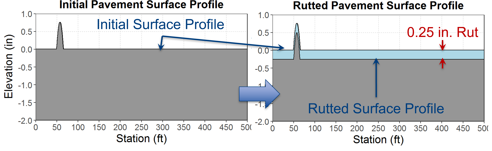{fig-align="center" width="96%" fig-alt="Figure 1. Uniform 0.25-in. rutting leaves IRI unchanged (Lee, 2019)."}

::: {.iri02-caption}
*Figure 1. Uniform 0.25-in. rutting leaves IRI unchanged (Lee, 2019).*
:::

The left-hand side of Figure 1 shows a 500-ft-long pavement profile. The surface is perfectly flat except for a single half-sine bump with a 0.75-in height over a distance of 15-ft. Let's assume this is our initial profile (before any significant traffic loading). The IRI I calculated for this profile is 31.1 in/mi.

Now suppose a conventional M-E distress model predicted 0.25-in rut depth for this pavement section. What can we do with this one representative rut depth? Let's say the pavement rutted 0.25-in uniformly along the entire 500-ft section length, as shown in the right-hand side of Figure 1. In this case, the entire 500-ft pavement surface profile moved down uniformly. The IRI for this "uniformly rutted" pavement surface is still 31.1 in/mi.

Why? Because lowering every point by the same amount does not change the SHAPE of the profile. The Golden Car encounters exactly the same bumps and valleys and accumulates exactly the same suspension movement. The same problem applies to a section-level cracking prediction. We may know how much cracking was predicted, but not necessarily the nonuniform change in elevation caused by the cracks along the 500-ft section length. This is the missing information for a profile-based Mechanistic-Empirical IRI prediction.

## A Few Empirical IRI Prediction Equations

Since our conventional M-E pavement analysis methods do not provide us with the inputs we want for M-E prediction of IRI, one question we should ask is, of course, the following.

[**“How is IRI predicted in current M-E pavement analysis procedures?”**]{.iri02-red}

The quick answer is that IRI predicted directly using purely empirical relationships. Let's take a look at a few examples. Table 1 shows 3 simple equation forms for empirical IRI prediction methods that frequently appear in literature. As you see in the table, these equations are mostly based on initial IRI (or *IRI₀*) and pavement age with some arbitrary coefficients β and γ that need to be determined from calibration.

**Table 1. Examples of empirical IRI prediction equations (from Lee, 2020).**

| Model type | Functional form |
|:--|:--|
| Exponential function | $IRI = IRI_0 \cdot e^{\beta \cdot Age}$ |
| Power function | $IRI = IRI_0 \cdot Age^{\beta}$ |
| Polynomial function | $IRI = IRI_0 + \beta \cdot Age + \gamma \cdot Age^2$ |

The regression-type equations shown in Table 1 are very straight forward, easy to understand, and useful for some applications for sure. I actually used one of these equation forms for one of my past research projects. But it is very obvious that these are empirical equations. There is nothing mechanistic about these equation forms.

Okay, then what about the IRI prediction model in AASHTOWare Pavement ME? This one is a little more interesting because it does not rely only on pavement age. More specifically, Pavement ME uses the following equation for predicting the IRI of flexible pavements.

::: {.iri02-equation-row}

$$
IRI = IRI_{0} + C_{1}(RD) + C_{2}(FC) + C_{3}(TC) + C_{4}(SF)
$$

<span class="iri02-equation-number">(1)</span>

:::

where *RD* is rut depth, *FC* is fatigue cracking, *TC* is transverse cracking, *SF* is site factor, and *C₁* through *C₄* are calibration coefficients.

At first glance, you may think, 'Well, rutting and cracking are predicted from M-E pavement analysis, so isn\'t this an M-E IRI prediction model?' Fair question! The distress predictions may indeed come from mechanistic pavement responses combined with empirical transfer functions. But take another look at Equation (1). Where is the future pavement profile? Where is the mechanistic Golden Car simulation? Neither one is there. The equation goes directly from predicted distresses and site factors to an IRI value using calibrated coefficients.

Therefore, even though this equation belongs to a larger M-E pavement design framework, the **IRI prediction itself is empirical**. It does not perform the mechanistic Golden Car simulation which is included in the definition of IRI. Am I saying that the equation is wrong? Absolutely not! It is practical, computationally efficient, and calibrated against observed pavement performance. I just want to distinguish between purely empirical IRI prediction models and the M-E methodology which still uses the mechanistic Golden Car model.

# 2. Mechanistic-Empirical (M-E) IRI Prediction -- The Basic Idea

Okay. I hope I have convinced you that it is the future pavement profile that we need to predict for M-E IRI prediction. But how can we predict the future profile of a pavement surface? A visual illustration of the basic idea is shown in Figure 2 and a quick summary of the procedure is provided below.

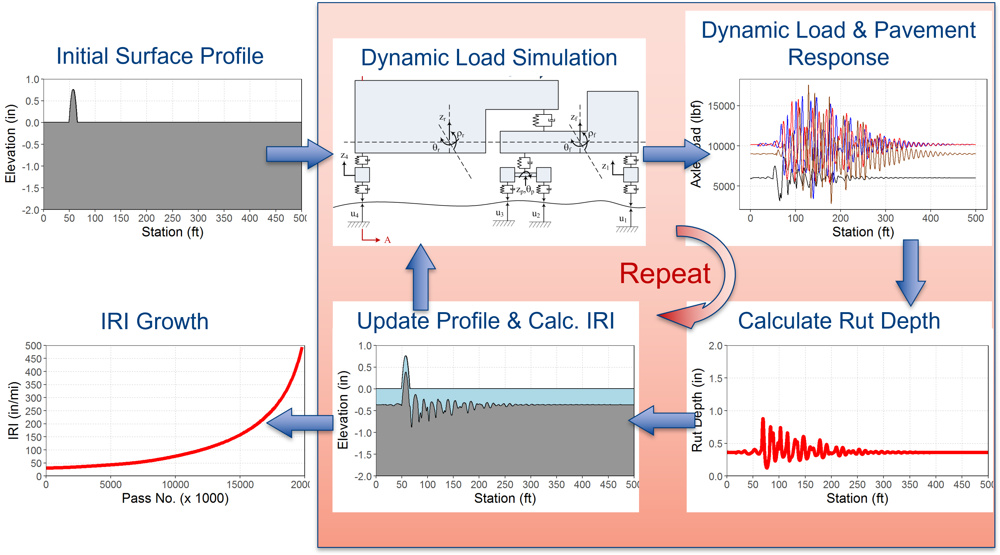{fig-align="center" width="96%" fig-alt="Figure 2. Profile-based M-E IRI prediction procedure."}

::: {.iri02-caption}
*Figure 2. Profile-based M-E IRI prediction procedure.*
:::

::: {.iri02-bluebox .iri02-steps}

**Mechanistic-Empirical (M-E) IRI Prediction Procedure**

1. Starting with an initial profile, simulate the response of a truck traveling over the profile using a **Vehicle Dynamics model**. The outcome is a “dynamic” or “time-varying” load magnitude for the tire(s) included in the vehicle model.
2. Predict the critical pavement response (i.e., stress or strain) under the time-varying or spatially varying load magnitude using a **Pavement Response model**. The outcome, of course, is the critical pavement response that varies along the length of the simulated section.
3. Using the spatially varying response and other relevant pavement-related inputs, predict the spatially varying permanent deformation along the roadway with **Empirical Transfer Functions**.
4. Update the pavement profile using the spatially varying permanent deformation and calculate IRI using the Golden Car simulation.
5. Repeat the above process.

:::

For the examples I will show you subsequently, I used two different truck models. Figure 3 shows the "Quarter-Truck" model. This represents the simplest mechanical vehicle model that you will find in literature and in vehicle-dynamic textbooks. And yes, it looks awfully similar to the "Quarter-Car" model, doesn't it? That is because both Quarter-Truck and Quarter-Car models share the same mechanical components. However, their properties are quite different. To keep it brief, let me just say that the Quarter-Truck model has a relatively stiffer suspension and a relatively weaker tire when compared to the Golden Car model. If you are interested, you can find the exact parameter values for the Quarter-Truck model in my FWDUG presentation.

Figure 4 shows the three-dimensional (3D) truck–trailer model with 14 Degrees of Freedom (DOFs). It may look a little more complicated, and yes, the math behind it is much more involved than the simple Quarter-Truck model. But in the vehicle dynamics world, this is still considered to be a simple model because it is just a bunch of masses, linear springs, and linear dashpots connected together. In reality, the vehicle suspensions and other components are highly nonlinear and much more complicated. But for me, I think this is good enough for what we are trying to do!

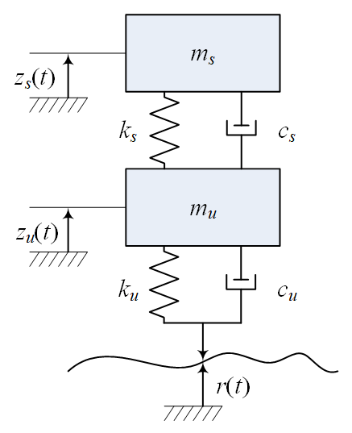{fig-align="center" width="46%" fig-alt="Figure 3. Quarter-truck model."}

::: {.iri02-caption}
*Figure 3. Quarter-truck model.*
:::

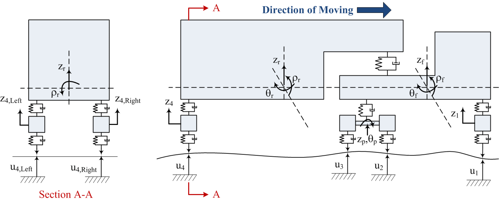{fig-align="center" width="96%" fig-alt="Figure 4. 3D truck–trailer model (14 DOFs)."}

::: {.iri02-caption}
*Figure 4. 3D truck–trailer model (14 DOFs).*
:::

As for the pavement response model, I used my moving-load implementation of ViscoWave to calculate the pavement responses under the moving tire loads. But for this purpose, you could use any pavement response model you feel comfortable with, as long as the model can produce the necessary responses for the next step.

Before I introduce the empirical transfer functions I used for my numerical experiments, let me first show you how the vehicle dynamics model and the pavement response model work together. Animation 1 shows the truck–trailer moving over a pavement profile, along with the dynamic tire loads predicted from the vehicle model. It also shows the associated pavement deflections predicted from ViscoWave, the pavement response model I used. On a personal note, Animation 1 is the very first animation I made for LinkedIn and I had it posted as a LinkedIn article rather than a post (Why? I have no idea now!).

```{=html}
<video controls preload="metadata" playsinline style="display:block;width:100%;max-width:850px;height:auto;margin:1rem auto;" aria-label="IRI-02 animation 1"><source src="media/Staley_Full_Truck_Tractor-2.mp4" type="video/mp4" />Your browser does not support HTML5 video.</video>
```

::: {.iri02-caption}
*Animation 1. Truck--trailer motion, tire loads, and pavement deflections ([Animation_1_LinkedIn_Post](https://lnkd.in/p/epzba9xY), [Animation_1_LinkedIn_Article](https://www.linkedin.com/pulse/pavement-deflection-under-moving-dynamic-load-3d-model-hyung-lee/)).*
:::

Animation 2 is essentially the same as Animation 1, but it also includes the longitudinal stress and strain responses at the bottom of the asphalt (which can be considered as the critical pavement response for fatigue cracking). So, it is much "busier" than Animation 1.

```{=html}
<video controls preload="metadata" playsinline style="display:block;width:100%;max-width:850px;height:auto;margin:1rem auto;" aria-label="IRI-02 animation 2"><source src="media/Staley_Full_Truck_Tractor_Deflection_Stress_Strain.mp4" type="video/mp4" />Your browser does not support HTML5 video.</video>
```

::: {.iri02-caption}
*Animation 2. Truck--trailer motion, deflections, stresses, and strains ([Animation_2_LinkedIn_Article](https://www.linkedin.com/pulse/pavement-deflection-stress-strain-under-moving-dynamic-hyung-lee/)).*
:::

Hope these animations gave you a better idea on how the spatially varying pavement responses were obtained from vehicle dynamics and pavement response models working together. Note that both these models are purely mechanistic. The last model we need is the empirical model or the transfer functions for calculating the spatially varying rut depth.

For my numerical experiments, I used two different rutting models for updating the pavement profile. The first is the AASHTOWare Pavement ME rutting model for the Asphalt Concrete (AC) layer. This empirical model is given as the following.

::: {.iri02-equation-row}

$$
RD_{AC} = \beta_{1r} k_z \varepsilon_{r(AC)} 10^{k_{1r}} n^{k_{2r}\beta_{2r}} T^{k_{3r}\beta_{3r}}
$$

<span class="iri02-equation-number">(2)</span>

:::

where *ε~z~*~(*AC*)~ is the vertical compressive strain at mid-depth of the AC layer, *n* is the number of load repetitions, *T* is the AC temperature, and *β* and *k* terms are the model coefficients. The important point is that the strain comes from the mechanistic pavement-response analysis, while the relationship that converts it into accumulated rutting is empirical.

The second model was for the subgrade rutting. For this, I used the Asphalt Institute relationship shown as the following.

::: {.iri02-equation-row}

$$
N_f = 1.365 \times 10^{-9} \varepsilon_{r(SG)}^{-4.477}
$$

<span class="iri02-equation-number">(3)</span>

:::

where *ε~z~*~(*SC*)~ is the vertical compressive strain on top of the subgrade layer and *N~f~* is the allowable number of load repetitions to reach a subgrade rut depth of 0.5-in. So, I also used the Miner's hypothesis along with Equation (3) to calculate the subgrade rut depth.

# 3. Four Numerical Experiments

Finally, I am ready to show you some examples on how the 3 models (vehicle dynamics, pavement response, and transfer functions) can come altogether to start predicting future profiles and how IRI changes! In these examples, I used a simple 3-layer pavement system: a 12-in AC layer and a 12-in base layer over subgrade with typical modulus inputs with AC being viscoelastic subjected to a temperature of 70˚F. I will first present some animations that show you how the surface profile changed from zero to 20 million passes of the truck (at every 50,000 passes), then look into the rut depths as well as the IRI.

## 3.1 Experiment #1 — One Bump and a Quarter-Truck Model

For Experiment #1, I returned to the same 500-ft pavement profile from Figure 1, a perfectly smooth pavement surface except for a single half-sine bump with a 0.75-in height over a distance of 15-ft. I used the Quarter-Truck model to obtain the dynamic loads, calculated the pavement response, and then used the empirical transfer functions to update the surface profile. Animation 3 shows how this pavement surface profile changes due to the varying rut depth along its length. Yes, this is a rather unrealistic pavement and at the same time, an unrealistic vehicle. That was intentional. I wanted to start with the simplest example before making the problem more complicated.

```{=html}
<video controls preload="metadata" playsinline style="display:block;width:100%;max-width:850px;height:auto;margin:1rem auto;" aria-label="IRI-02 animation 3"><source src="media/halfsine-quarter-truck.mp4" type="video/mp4" />Your browser does not support HTML5 video.</video>
```

::: {.iri02-caption}
*Animation 3. Single bump with a quarter-truck model.*
:::

Not bad for a first trial, right? Figure 5 shows the progression of the total (i.e., asphalt + subgrade) rut depth averaged over the 500-ft section length. Note that there are 2 different series in the plot. The "Without Dynamic Load" is the rut depth that the empirical transfer function predicted under the "static weight" of the Quarter-Truck which in this case was 9,000 lbs. This is basically the scenario that will give us a "constant rut depth" throughout the section (and hence no increase in IRI) as we saw in Figure 1.

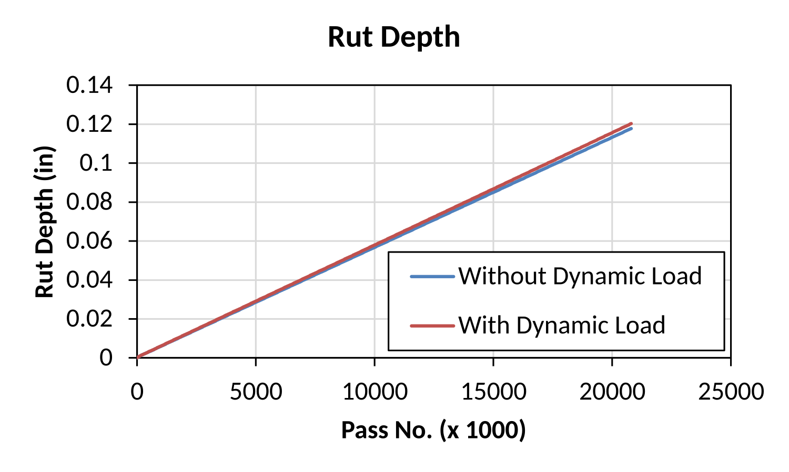{fig-align="center" width="83%" fig-alt="Figure 5. Experiment #1: representative rut depth."}

::: {.iri02-caption}
*Figure 5. Experiment #1: representative rut depth.*
:::

The other rut depth "With Dynamic Load" corresponds to the "average" of the spatially varying rut depth. Because the spatially varying dynamic load oscillates around its static weight of 9,000 lbs, the average of the dynamic load over the 500-ft section is almost equal to its static weight. Consequently, the average dynamic response was close to the static response, and even after when these responses were passed through the highly nonlinear transfer functions, the average rut depths over the entire 500-ft section were quite close (with and without dynamic load) for the range of rut depth predicted here (mostly below 0.12-in).

We already discussed that if we do not consider the dynamic load (or vehicle dynamics) and only consider the constant rut depth, the IRI will not change. So, in Figure 6, I am only showing you how the IRI changed based on M-E prediction with vehicle dynamics effect. After approximately 20 million simulated truck passes, IRI increased from 31.1 to 40.3 in/mi. Not exactly a dramatic change! Even though the average dynamic load was nearly identical to its static counterpart, the permanent deformation was not necessarily the same at every station (and that's what you saw in Animation 3!). And those local changes in profile were enough to increase the IRI, although the overall increase in IRI was not all that significant.

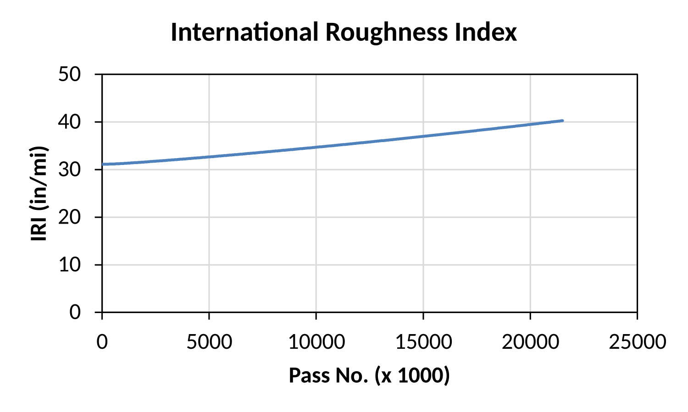{fig-align="center" width="83%" fig-alt="Figure 6. Experiment #1: M-E predicted IRI progression."}

::: {.iri02-caption}
*Figure 6. Experiment #1: M-E predicted IRI progression.*
:::

## 3.2 Experiment #2 — Perfectly Smooth Pavement, but Something Is Different Underneath

For Experiment #2, I decided to make the pavement even simpler. I removed the bump and started with a perfectly flat 500-ft-long profile. In other words, the initial IRI was literally 0.0 in/mi. There was not a single bump or dip for the Golden Car to respond to. So, how could this pavement possibly become rougher?

Well, I changed something else below the pavement surface. Over a 15-ft section, the AC thickness was reduced from 12-in to 6-in, as shown in Figure 7. You can think of it as a hypothetical patch with a perfectly smooth finished surface. The pavement looked perfectly uniform from the surface, but it certainly was not underneath. I used the same Quarter-Truck model and empirical transfer functions as Experiment #1 to calculate how the rutting developed along the section. Animation 4 shows the resulting profile changes.

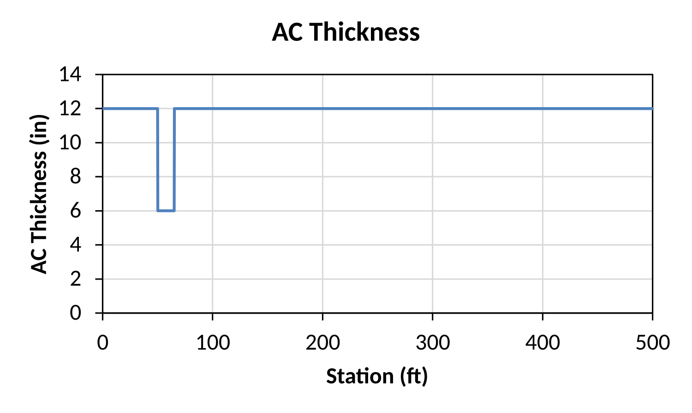{fig-align="center" width="83%" fig-alt="Figure 7. Experiment #2: localized AC thickness reduction."}

::: {.iri02-caption}
*Figure 7. Experiment #2: localized AC thickness reduction.*
:::

```{=html}
<video controls preload="metadata" playsinline style="display:block;width:100%;max-width:850px;height:auto;margin:1rem auto;" aria-label="IRI-02 animation 4"><source src="media/thickness-quarter-truck.mp4" type="video/mp4" />Your browser does not support HTML5 video.</video>
```

::: {.iri02-caption}
*Animation 4. Smooth surface with a localized AC thickness change.*
:::

Figure 8 shows the "average" rut depth results for both cases with and without dynamic load (or vehicle dynamics). For a fair comparison, the **15-ft patched section was completed excluded** when I calculated the average rut depths. So, the two curves in this figure represent the average rut depth outside the thinner section. Compared to what we had in Figure 5 for Experiment #1, the simulation with dynamic load showed a little more "deviation" from its static counterpart. Is this significant? Probably not when you are only looking at the averages of 0.13-in (with dynamics) and 0.12-in (without dynamics). But again, these are just the "Average" values which do not necessarily tell us how "rough" the pavement surface became. As you saw from Animation 4, the surface profile clearly seemed "rougher" than what we saw in Experiment #1. So, how was IRI affected?

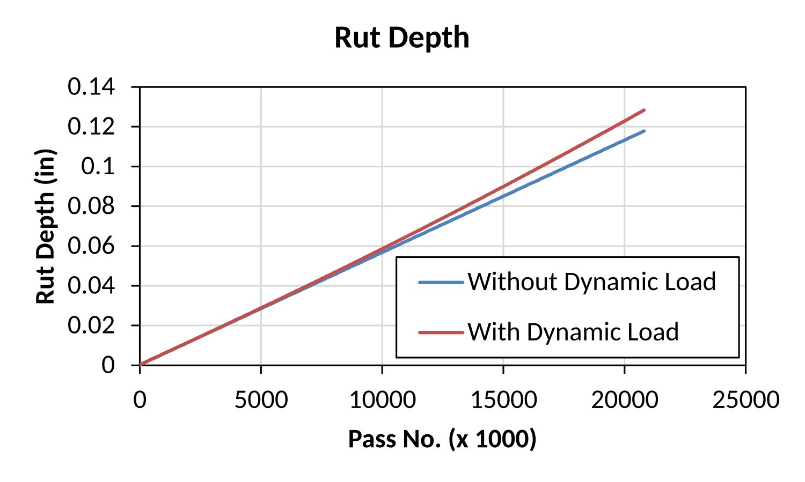{fig-align="center" width="83%" fig-alt="Figure 8. Experiment #2: average rut depth EXCLUDING the patched area."}

::: {.iri02-caption}
*Figure 8. Experiment #2: average rut depth EXCLUDING the patched area.*
:::

Figure 9 shows the profile-based M-E prediction of IRI with vehicle dynamics effects. After approximately 20 million truck passes, the IRI increased from **0.0 to 93.8 in/mi (Whoa!)**. Remember, I started with a perfectly flat pavement surface. The thinner AC section responded differently to the applied loads and accumulated more rutting than its surrounding pavement. As a result, the profile was no longer flat and the Golden Car simply responded to the new "irregularity" produced by this differential rutting.

[**The pavement was initially smooth, but it was not structurally uniform. And eventually, the surface showed it.**]{.iri02-maroon}

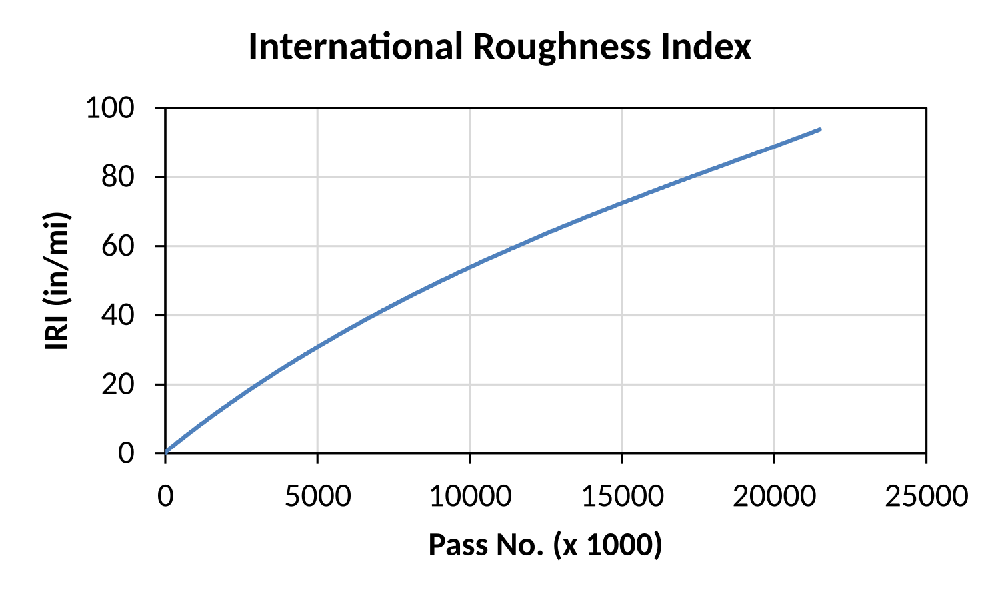{fig-align="center" width="83%" fig-alt="Figure 9. Experiment #2: M-E predicted IRI progression."}

::: {.iri02-caption}
*Figure 9. Experiment #2: M-E predicted IRI progression.*
:::

## 3.3 Experiment #3 — Same Bump, but Now I Bring in the Whole Truck

Now, let's bring back our single-bump pavement from Experiment #1. But this time, I replaced the Quarter-Truck with the 3D truck–trailer model shown in Figure 4. Its 14 DOFs allow the vehicle body and multiple axles to respond simultaneously as the truck travels over the bump. Compared with the Quarter-Truck, the model is more complicated, but that would not be a surprise, right?

The basic prediction procedure did not change at all. I calculated the dynamic tire loads using vehicle dynamics model, passed them through the pavement response model, used the empirical rutting relationships to update the longitudinal profile, and ran the Golden Car simulation for IRI. What changed was the vehicle dynamics and, therefore, the spatial distribution of tire loads. I wanted to see how much difference that could make. Animation 5 shows how the single-bump profile gets updated under this 3D truck-trailer model.

```{=html}
<video controls preload="metadata" playsinline style="display:block;width:100%;max-width:850px;height:auto;margin:1rem auto;" aria-label="IRI-02 animation 5"><source src="media/halfsine-full-truck.mp4" type="video/mp4" />Your browser does not support HTML5 video.</video>
```

::: {.iri02-caption}
*Animation 5. Single bump with the 3D truck–trailer.*
:::

Figure 10 shows the average rut depth history for both scenarios with and without dynamic loads. Now we have a completely different result. After roughly 20 million passes, the rutting under dynamic loads showed about 40% more representative rutting on average. It is also interesting to see that for the simulation with dynamic loads (or vehicle dynamics), the average rut depth started to grow almost exponentially at around 18 million passes of the truck-trailer system.

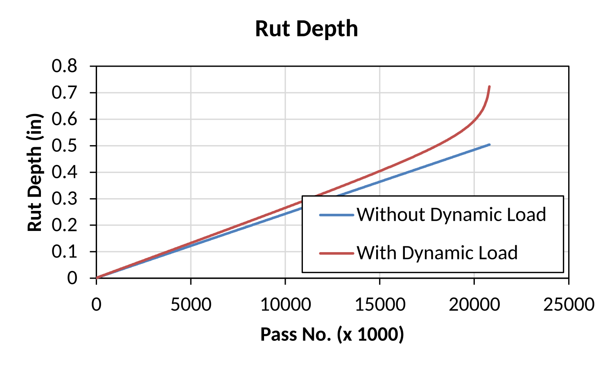{fig-align="center" width="83%" fig-alt="Figure 10. Experiment #3: representative rut depth."}

::: {.iri02-caption}
*Figure 10. Experiment #3: representative rut depth.*
:::

Surprised at the rut depth results? Then take a look at Figure 11 which shows the M-E IRI prediction for the dynamic scenario. The final IRI exceeded 1,000 in/mi. Yes, 1,000 in/mi (Thank god it was the Golden Car driving over it, not my vehicle!). Before anyone takes this 1,000 in/mi prediction too seriously, let me emphasize something. This was a deliberately simplified numerical experiment. I allowed the simulated pavement to deteriorate for about 20 million passes of the full truck-trailer system without any maintenance or rehabilitation, and the resulting surface became unrealistically rough. The goal was to show you the difference the truck models can make (i.e., compare results from Experiments 1 and 3), not to predict the actual condition of a highway after 20 million passes in a realistic manner.

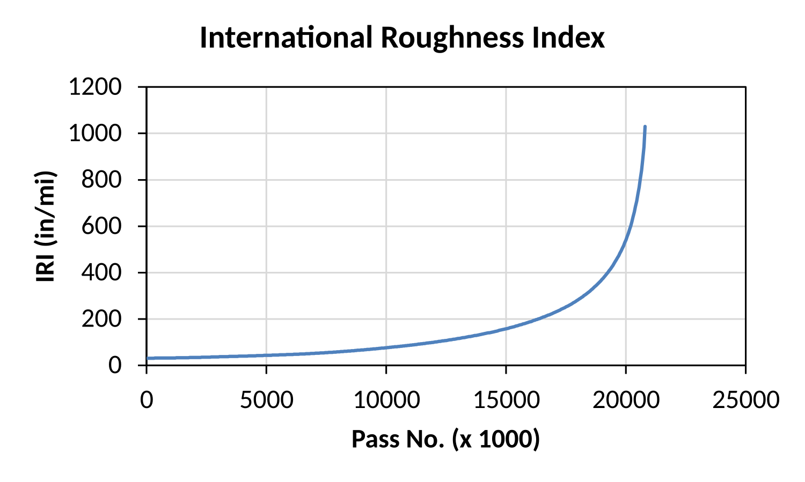{fig-align="center" width="83%" fig-alt="Figure 11. Experiment #3: M-E predicted IRI progression."}

::: {.iri02-caption}
*Figure 11. Experiment #3: M-E predicted IRI progression.*
:::

## 3.4 Experiment #4 — A Real LTPP Profile and a 3D Truck--Trailer

For my last experiment, I wanted to use a real pavement profile rather than another hypothetical artifact on the pavement surface. So, I started with an actual measured pavement profile from Long-Term Pavement Performance (LTPP) section 04-0261 in Arizona. The profiles were obtained shortly after construction of this pavement in 1994. The initial IRI was 38.9 in/mi in the left wheel path and 52.4 in/mi in the right wheel path.

No Quarter-Truck simulation for this example, as I only simulated the 3D truck–trailer at 60 mph. For the pavement structure, I used the same structure as all other experiments (i.e., 12-in AC / 12-in base / subgrade) rather than the actual LTPP pavement structure.

Just like the earlier experiments, I used the calculated pavement responses and empirical transfer functions to estimate location-dependent permanent deformation along the wheel paths. The predicted rutting changed the surface profiles, and I calculated the corresponding IRI using the Golden Car. I also estimated fatigue damage, but I did NOT necessarily translate this to actual cracking or any changes in surface profile. So, for this example, the predicted IRI growth still came from spatially varying rutting only. Animation 6 shows how the profiles of this LTPP section change along with the estimated fatigue damage.

```{=html}
<video controls preload="metadata" playsinline style="display:block;width:100%;max-width:850px;height:auto;margin:1rem auto;" aria-label="IRI-02 animation 6"><source src="media/ltpp-full-truck.mp4" type="video/mp4" />Your browser does not support HTML5 video.</video>
```

::: {.iri02-caption}
*Animation 6. LTPP 04-0261 truck and pavement simulation.*
:::

Figures 12 and 13 summarize the corresponding rutting and fatigue-damage comparisons from the Left Wheel Path (LWP), respectively. Nothing dramatically different from what we already saw in previous examples. But let me point out one thing regarding Figure 13. The simulation with vehicle dynamics resulted in about twice as much fatigue damage compared to the static simulation. However, the magnitude of fatigue damage was still very small (\<2%) for both cases. At this level of damage, we can safely assume that no cracking on the pavement surface.

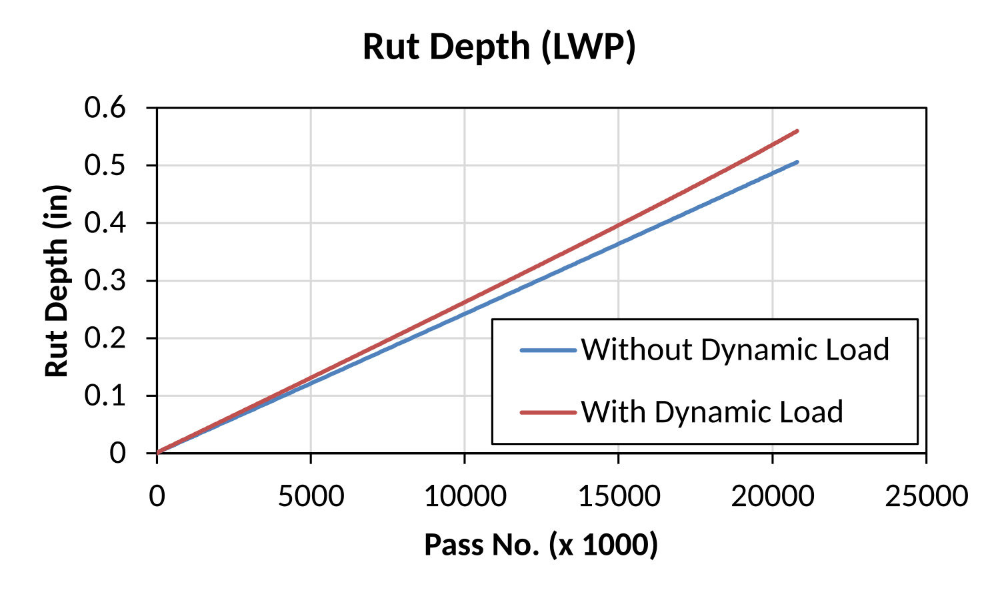{fig-align="center" width="83%" fig-alt="Figure 12. Experiment #4: representative rut depth (LWP)."}

::: {.iri02-caption}
*Figure 12. Experiment #4: representative rut depth (LWP).*
:::

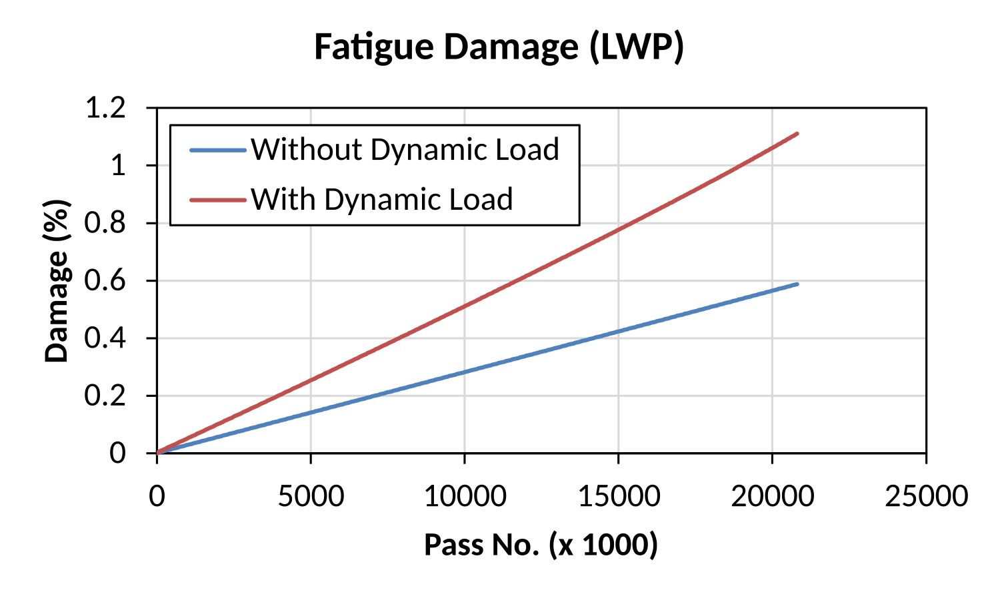{fig-align="center" width="83%" fig-alt="Figure 13. Experiment #4: fatigue damage (LWP)."}

::: {.iri02-caption}
*Figure 13. Experiment #4: fatigue damage (LWP).*
:::

Finally, Figure 14 shows the M-E IRI prediction results for both wheel paths. Both wheel paths start becoming rougher at a relatively slow pace, but then after about 10 million passes of the truck-trailer system, the IRI starts picking up very quickly and increases almost exponentially.

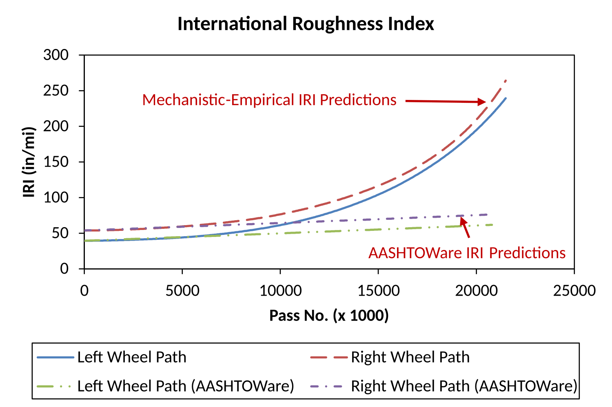{fig-align="center" width="96%" fig-alt="Figure 14. LTPP 04-0261: M-E profile-based versus AASHTOWare IRI predictions."}

::: {.iri02-caption}
*Figure 14. LTPP 04-0261: M-E profile-based versus AASHTOWare IRI predictions.*
:::

Now, let's ask another interesting question. How do these profile-based M-E IRI prediction results compare to the empirical IRI equation in AASHTOWare Pavement ME (which does not consider vehicle dynamics or spatially varying rut depth)?

Recall from Equation (1) that the rutting model in Pavement ME is a linear model including rut depth (*RD*), fatigue cracking (*FC*), transverse cracking (*TC*), and site factor (*SF*). Let's think about this. Under my assumed condition of constant AC temperature of 70°F, there cannot be any transverse or thermal cracking (i.e., *TC* = 0). There obviously cannot be any freeze-thaw effects and this simulated pavement never received any precipitation, so *SF* = 0. Furthermore, according to Figure 13, the fatigue damage was less than 2% which is not enough to induce any full depth cracks, so *FC*=0. So, the only parameter that can increase the IRI is rut depth and IRI was a linear function of the average rut depth. That is exactly why you see the 2 linearly increasing IRI predictions in Figure 14.

Now, does this mean the M-E IRI prediction is more accurate than the empirical methodology in AASHTOWare? Not necessarily**!** The empirical model was calibrated for practical pavement performance prediction. My numerical experiment was never validated against actual future pavement profiles, and it is probably more difficult to calibrate or verify the profiles that change over time. But you know what? It is definitely a fun concept!

Before I conclude this section, here is a bonus animation for everyone. It basically combines the profile and IRI plot into a single animation for the left wheel path of this experiment. Surprisingly, out of all 4 experiments, this was the only animation that was posted on LinkedIn.

```{=html}
<video controls preload="metadata" playsinline poster="media/iri02-preview.png" style="display:block;width:100%;max-width:850px;height:auto;margin:1rem auto;" aria-label="IRI-02 animation 7"><source src="media/iri02-mechanistic-iri-progression-3x.mp4" type="video/mp4" />Your browser does not support HTML5 video.</video>
```

::: {.iri02-caption}
*Animation 7. LTPP 04-0261 profile and IRI progression ([Animation_7_LinkedIn_Post](https://lnkd.in/p/e72dByeT)).*
:::

# 4. So, What Did These Four Experiments Tell Us?

So, what did we learn from all four experiments? The answer is actually rather simple. How much a pavement ruts is not necessarily the same as where it ruts. A representative rut-depth from static simulation can tell us how much it rutted, but the Golden Car needs to know where and how much it rutted for updating the longitudinal profile.

Let's summarize the experiments. In Experiment #1, the IRI increased only modestly, even though the average rutting with and without vehicle dynamics was nearly identical. Experiment #2 started with a perfectly smooth surface and developed roughness because of a hidden AC thickness variation. Experiment #3 showed how sensitive the results could become when a 3D truck–trailer model was used, although its extreme final IRI was clearly unrealistic. Finally, Experiment #4 used a measured LTPP profile rather than a hypothetical one. Different examples, but the same lesson. **Spatial variability matters**.

There is another interesting part of these simulations. It is the feedback between the pavement and the truck. The pavement profile affects the vehicle motion and tire loads. Those loads affect pavement response, which the empirical transfer functions use to estimate permanent deformation. The permanent deformation then changes the profile and may change the tire loads during the next round of passes. So, the truck and pavement keep influencing each other. And the Golden Car calculates the IRI from whatever profile results. Sounds straightforward when I put it that way, doesn\'t it?

I also want to emphasize again that I am not saying the M-E IRI prediction methods are superior to the empirical methods. The empirical methods are practical, computationally efficient, and calibrated using field observations. My point is that predicting an IRI value from representative distresses and predicting the future profile before calculating IRI are two different approaches. I think it is worth being clear about that distinction.

# 5. Limitations — Because Models Are Still Models

I want to emphasize that these were numerical experiments, not field-validated IRI forecasts. The first three examples used hypothetical profiles, and even the fourth (although it started with a measured LTPP profile) used simulated deterioration after that initial measurement. The animations help illustrate the mechanisms, but they do not, by themselves, demonstrate predictive accuracy.

I also made quite a few simplifying assumptions. The vehicle models were relatively simple, the pavement properties and rutting relationships were prescribed, and the LTPP simulation used a constant 70°F AC temperature and the same truck configuration throughout. I did not account for any pavement rehabilitation, traffic wander, changing climate, or crack-induced changes in surface elevation. Real pavement deterioration is a little more complicated than my computer experiments!

There is another problem that becomes especially important for **PAVEMENT DESIGN**. If we are evaluating an existing road, we can measure its longitudinal profile and use that as our starting point. But what if the pavement has not even been constructed? We obviously have no profile to measure! We may be able to specify an initial IRI, but that single number cannot tell us what the actual profile looks like. In fact, many very different profiles can have the same IRI. We would need a reasonable way to represent the future as-constructed profile before we could even begin updating it. And, of course, repeating the truck dynamics, pavement analysis, rutting calculations, and Golden Car simulations over millions of passes is not exactly cheap computationally. We have a standard Golden Car for IRI, but no universally accepted Golden Truck for predicting dynamic tire loads.

# 6. Closing Thoughts

In [IRI-01](https://leehyu20.github.io/hyung-s-lee/posts/iri-what-is-iri/), I explained how to calculate IRI from a known pavement profile using the Golden Car. In IRI-02, I wanted to ask a different question: can we predict what that pavement profile will look like in the future? Once we have the future profile, we already know how to calculate IRI. The difficult part is predicting how the surface changes under repeated traffic loading, not running the Golden Car.

In my personal opinion, I like Experiment #2 the most. I started with a perfectly flat pavement, so its initial IRI was ZERO. But I had reduced the AC thickness over one short section, where the resulting permanent deformation differed from the surrounding pavement. Eventually, that difference created a surface irregularity and the IRI increased. The initial IRI did not tell me about the structural difference hiding underneath. And the average rut depth **outside the patched section** did not tell me where the new roughness developed. Simple example, but perfect for proving that it is not only about the initial pavement profile that matters. Any structural variability in the pavement itself can also affect the ride quality in the long term!

So, are we ready to predict future IRI accurately for every pavement? Unfortunately, NO. The experiments were preliminary, and the challenges (especially predicting spatial deterioration and defining an initial profile for a pavement that does not yet exist) are still substantial. But I hope they illustrate why predicting a representative distress value is NOT the same as predicting future roughness. As usual, I started with what seemed like a simple question and ended up with quite a few more!

# References

1.  Lee, H. S. (2019). Effect of Moving Dynamic Loads on Pavement Performance. Presentation at the FWD User Group meeting, Alpharetta, Georgia. Original source of the four numerical examples and animations.

2.  Lee, H. S. (2020). Towards a Mechanistic-Empirical IRI Prediction. Conference paper (provided manuscript). Includes the methodology and LTPP section 04-0261 case study.

3.  Lee, H. S. (2026). IRI-01 \| What Exactly Is the International Roughness Index (IRI), and How Is It Calculated? Research website: https://leehyu20.github.io/hyung-s-lee/posts/iri-what-is-iri/

4.  Sayers, M. W. (1995). "On the Calculation of International Roughness Index from Longitudinal Road Profile." Transportation Research Record, No. 1501, pp. 1--12. https://trid.trb.org/View/452992
