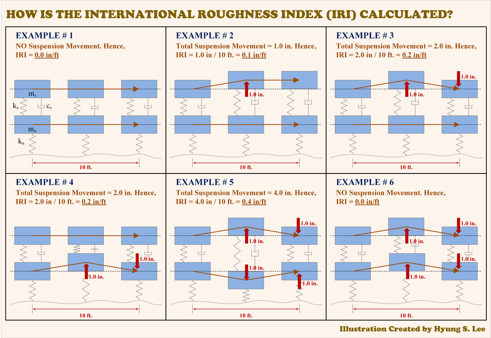
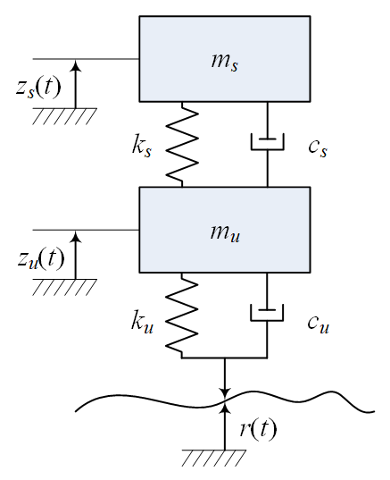
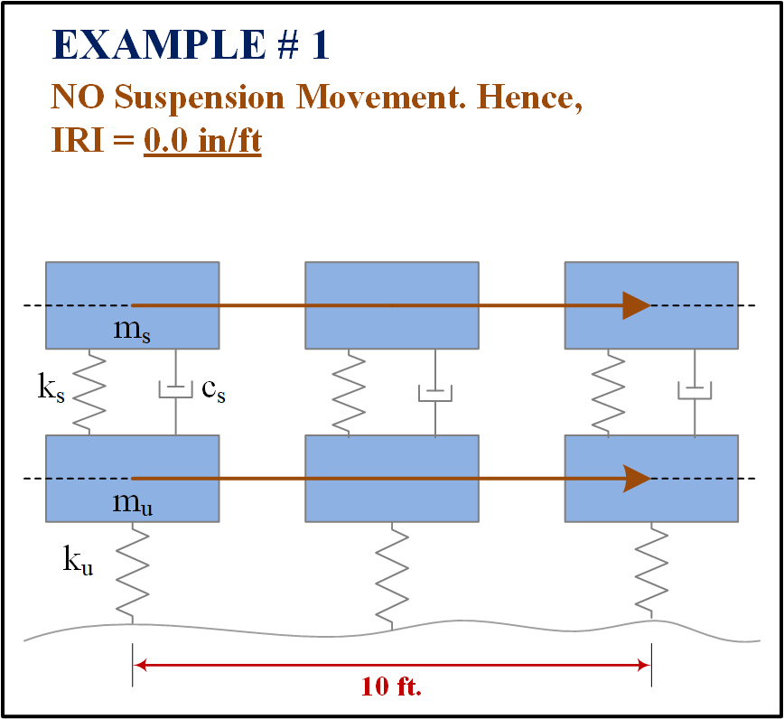
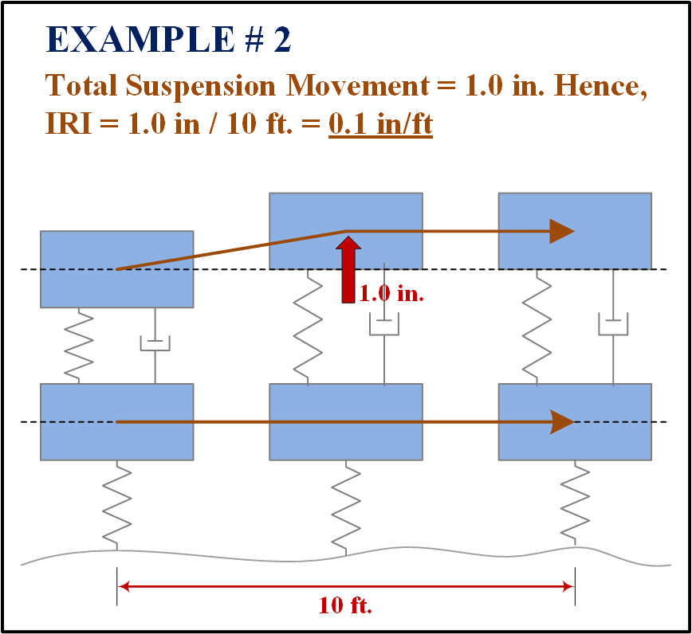
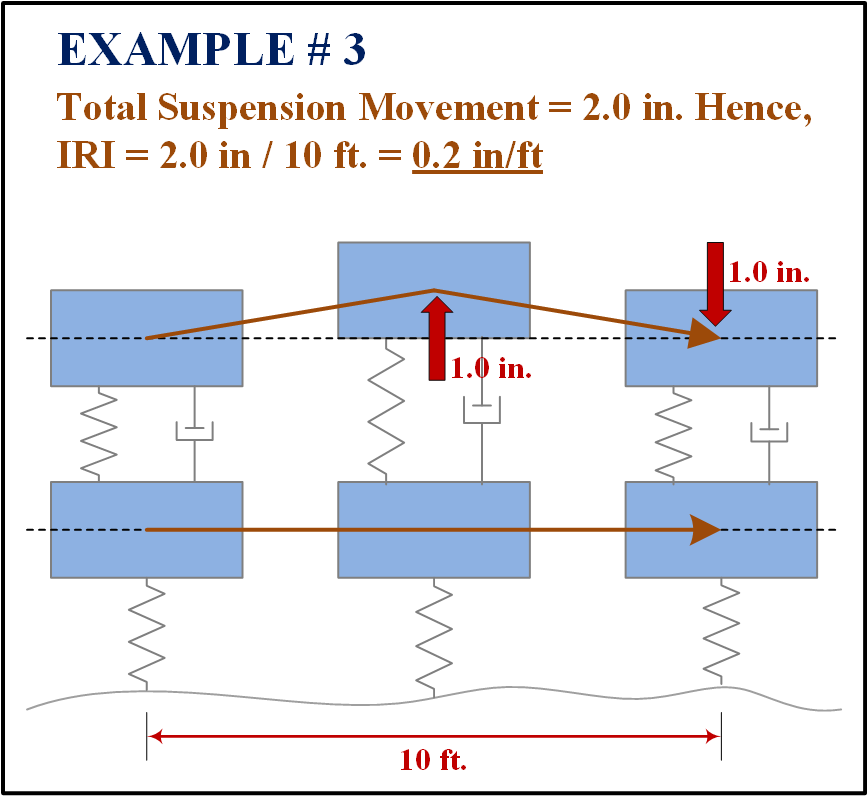
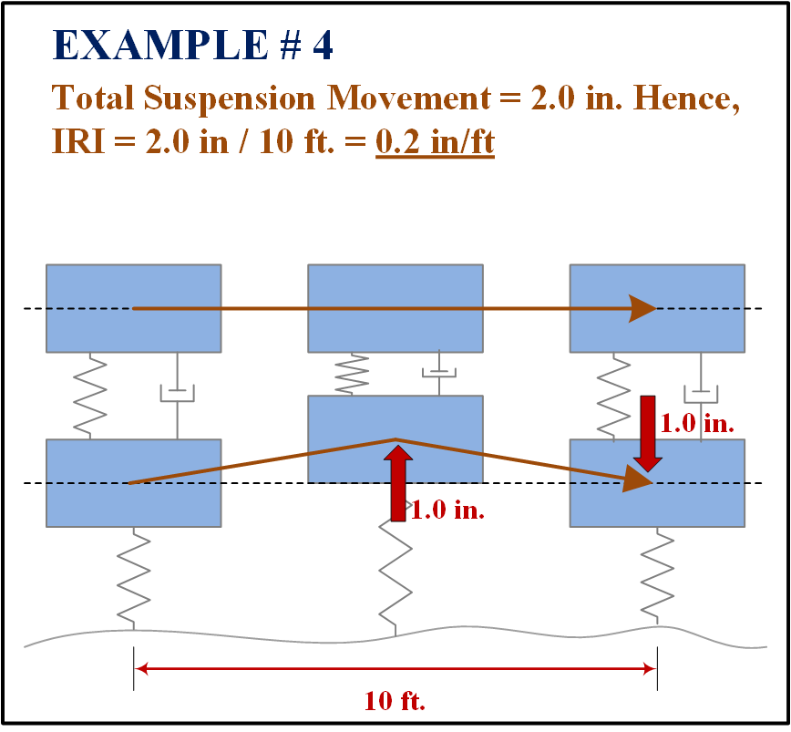
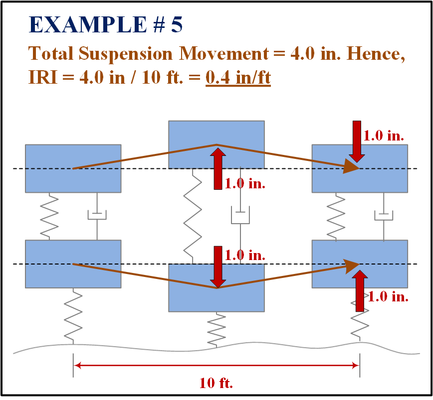
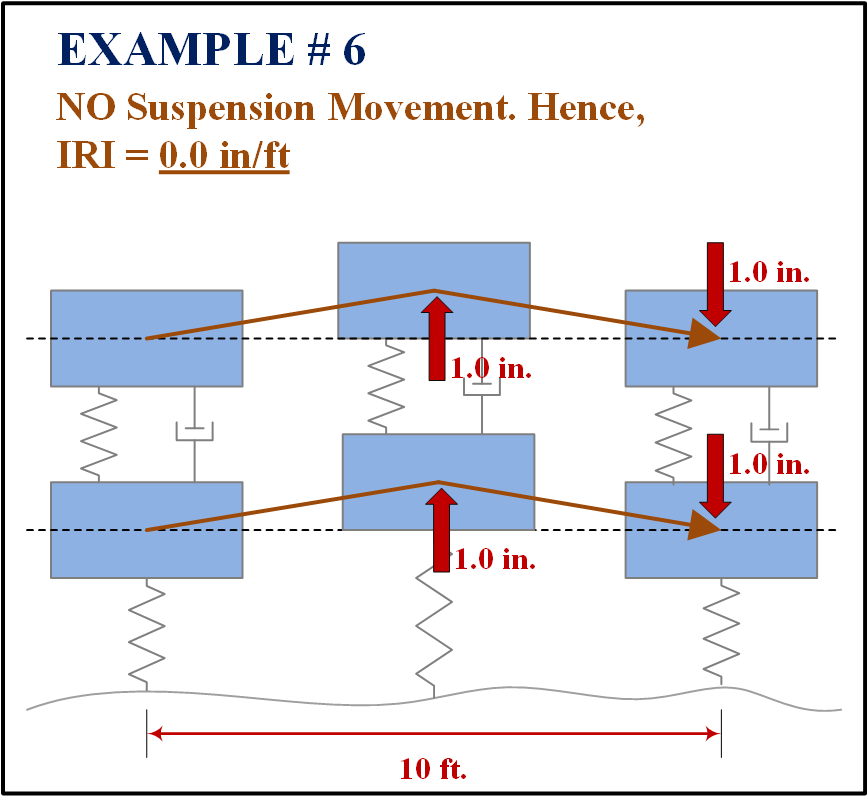

::: {.article-series-label}
**Pavement Roughness Article Series · IRI-01**
:::

This article is based on my illustration (Image shown below) that I posted on LinkedIn in March 2025 and the "IRICoaster" animations I posted on LinkedIn back in 2023.

{fig-align="center"}

*Figure 1. Six hypothetical examples illustrating the accumulation of relative suspension movement* **([Figure_1_LinkedIn_Post](https://lnkd.in/p/evYdmTNy))***.*

# 1. Introduction: What Does IRI Actually Measure?

The International Roughness Index (IRI) is one of the most widely used indicators of pavement ride quality or smoothness. It is also frequently described as a "roughness measurement". Strictly speaking, however, this is not true. A road profiler measures pavement surface elevation (also frequently called the longitudinal profile) and IRI is subsequently "calculated" from that profile using a standardized mathematical vehicle model.

This distinction may seem minor, but it matters. IRI is not simply the height of bumps, the maximum deviation from a straight line, or the vertical acceleration experienced by a particular driver. [**It is a precise and mathematical summary of how a specified theoretical quarter-car suspension responds when traversing a longitudinal road profile**]{.darkred}.

Over the past two decades, I have talked to many pavement engineers about IRI and pavement smoothness in general. However, when I asked whether they knew how IRI is calculated, the most common answer I get is simply "It is calculated from a Quarter Car simulation". When I asked to be more specific, I received a lot of different answers from "I don't know" or "I am not sure" to "IRI is calculated from the suspension response of the Quarter Car" or "Accumulated Quarter Car motion". But what exactly is the "suspension response" and what is "accumulated"?

This article was developed to provide answers to the above question using some fictitious examples I had provided in one of my LinkedIn posts along with some additional background, discussion, and some fun stuff that I brought from a couple of my other previous LinkedIn posts.

# 2. Full Definition of IRI by Sayers (1995)

If I asked you what the "Definition of IRI" is, what would you tell me? I could imagine some answers similar to "IRI is obtained from the accumulated suspension motion of a Golden Car simulation using a measured profile". Actually, this is pretty good! But the brutal truth is that IRI cannot be defined with a simple sentence or two.

According to Sayers (1995), the full definition of IRI spans five bullet points. The following five points are reproduced verbatim from Sayers (1995) for its full definition.

::: {.callout-note .myth-verdict appearance="simple" icon=false}

**Full Definition of IRI (from Sayers, 1995)**

1. IRI is computed from a single longitudinal profile. The sample interval should be no larger than 300 mm for accurate calculations. The required resolution depends on the roughness level, with finer resolution being needed for smooth roads. A resolution of 0.5 mm is suitable for all conditions.

2. The profile is assumed to have a constant slope between sampled elevation points.

3. The profile is smoothed with a moving average whose base length is 250 mm.

4. The smoothed profile is filtered using a quarter-car simulation, with specific parameter values (Golden Car), at a simulated speed of 80 km/hr (49.7 mph).

5. The simulated suspension motion is linearly accumulated and divided by the length of the profile to yield IRI. Thus, IRI has units of slope, such as inches per mile or meters per kilometer.

:::

As you see from the above, the first 3 bullets in the above are more or less related to the longitudinal profile which is the input used for calculating IRI, or its measurement. These bullets were included to ensure that the equipment used for data collection or the longitudinal profile itself meets some minimum requirement. However, remember that the IRI was first developed in the 1980's. Most of the equipment that we have nowadays for longitudinal profile data collection can easily meet and exceed these minimum requirements. So, we will not worry about these first 3 bullets herein.

The last 2 bullets of the above definition delve into the actual calculation of IRI and we will focus on those items in this article. Bullet #4 specifically mentions the "Golden Car" which is a Quarter Car with specific parameter values. It also spells out a speed of 80 km/hr (49.7 mph) specifically. Note that these are all part of the IRI definition, meaning if you change any parameter(s) of the Quarter Car model or if you change the speed of the simulation speed from 80 km/hr (49.7 mph) to something else, the outcome you get from the simulation cannot be called IRI even if you followed the exact same procedure elsewhere.

So, what are the "Parameter Values" for the Golden Car mentioned in Bullet #4? Let's take a look at these values before getting into Bullet #5 which is related to the actual calculation of IRI.

# 3. The Golden Car: A Standardized Quarter-Car Model

As mentioned above, the Golden Car is nothing more than a Quarter Car with specific parameters. Well then... what is a Quarter Car? Figure 2 shows the "generic" form of a Quarter Car model.

{fig-align="center"}

**Figure 2. Quarter Car Model.**

As shown in the above figure, the Quarter Car is nothing more than a theoretical model with two vertical degrees of freedom (*z~s~* and *z~u~*), two masses (*m~s~* and *m~u~*), two springs (*k~s~* and *k~u~*), and two dashpots (*c~s~* and *c~u~*). These parameters are defined in the following table.

**Table 1. Description of parameters for the Quarter Car model.**

  ------------------------------------------------------------------------------------------------------
  **Type**                  **Parameter**     **Description**
  ------------------------- ----------------- ----------------------------------------------------------
  Mass                      *mₛ*              Sprung mass representing a portion of the vehicle body

                            *mᵤ*              Unsprung mass representing the wheel/axle assembly

  Spring                    *kₛ*              Suspension stiffness

                            *k~u~*            Tire stiffness (Sayer's illustration labels this *k~s~*)

  Dashpot                   *cₛ*              Suspension damping coefficient

                            *c~u~*            Tire damping coefficient

  Degree of Freedom (DOF)   *zₛ*              Vertical displacements of the sprung mass

                            *zᵤ*              Vertical displacements of unsprung mass

  Elevation                 *r*               Road elevation input along the profile
  ------------------------------------------------------------------------------------------------------

Now that we know the individual components of a Quarter Car, let's return to Golden Car. As mentioned earlier, the Golden Car is a Quarter Car model with a specific set of mechanical parameters. These parameters are not selected based on the pavement being evaluated, a vehicle traveling on it, or the preferences of the engineer performing the analysis. They are standardized. According to Sayers (1995), the Golden Car is defined by the following normalized parameters:

::: {.iri-equation-row}

$$
\frac{c_{s}}{m_{s}} = 6.0\ s^{- 1}
$$

<span class="iri-equation-number">(1)</span>

:::

::: {.iri-equation-row}

$$
\frac{k_{u}}{m_{s}} = 653\ s^{- 2}
$$

<span class="iri-equation-number">(2)</span>

:::

::: {.iri-equation-row}

$$
\frac{k_{s}}{m_{s}} = 63.3\ s^{- 2}
$$

<span class="iri-equation-number">(3)</span>

:::

::: {.iri-equation-row}

$$
\frac{m_{u}}{m_{s}} = 0.15
$$

<span class="iri-equation-number">(4)</span>

:::

Note that in the above equations, the parameters are normalized by the sprung mass (*m~s~*). Consequently, we do not need to specify the actual mass of a vehicle to define the Golden Car. What matters are the relationships among its mechanical properties.

You may also have noticed that the generic Quarter Car model I showed in Figure 2 is different from what Sayers (1995) has in his paper. Figure 2 includes a dashpot (*c~u~*) for the tire, whereas the standardized Golden Car does not. This is intentional. The Golden Car assumes an "elastic" tire without any damping. So, the Golden Car tire is only represented by a spring, while I prefer to keep the dashpot for the tire in the generic Quarter Car model because I have used it for different purposes. All in all, the Quarter Car in Figure 2 becomes the Golden Car if we specify Equations (1) through (4) and eliminate the tire dashpot. Hence for the Golden Car:

::: {.iri-equation-row}

$$
c_{u} = 0
$$

<span class="iri-equation-number">(5)</span>

:::

Remember, the above parameters shown in Equations (1) through (5) and the standard speed of 80 km/h (49.7 mph) are part of the IRI definition. You can certainly change any of them in your own vehicle dynamics simulations (which I have done many times), but the resulting index (if that is what you calculated) can no longer be referred to as the IRI.

# 4. Is the Golden Car Realistic? Which Vehicle Does It Represent?

Before getting into the equations, let's have a little fun. Back in 2023, I developed a couple of animations showing what it might look like to "ride" on top of the sprung mass of the Golden Car. Rather than just showing the Golden Car model from the side, I placed a virtual camera on the sprung mass and looked forward as the model traveled over a pavement profile. I called these animations "IRICoasters" because they reminded me of roller-coaster simulation videos, except that the ride takes place over a pavement profile instead of a roller-coaster track.

Animations 1 and 2 show the IRICoaster simulations over a rough flexible pavement (IRI = 135.3 in/mi) and a rough rigid pavement with a lot of curling of the jointed slabs (IRI = 134.1 in/mi), respectively. Hope you don't get sick!

```{=html}
<video controls preload="metadata" playsinline style="display:block;width:100%;max-width:850px;height:auto;margin:1rem auto;" aria-label="IRICoaster animation 1"><source src="media/flexible-iri-coaster.mp4" type="video/mp4" /></video>
```

**Animation 1. An imaginary ride in the Golden Car over a flexible pavement profile, IRI = 135.3 in/mi ([Animation_1_LinkedIn_Post](https://lnkd.in/p/ecQp7kHy)).**

```{=html}
<video controls preload="metadata" playsinline style="display:block;width:100%;max-width:850px;height:auto;margin:1rem auto;" aria-label="IRICoaster animation 2"><source src="media/rigid-iri-coaster.mp4" type="video/mp4" /></video>
```

**Animation 2. An imaginary ride in the Golden Car over a rigid pavement profile, IRI = 134.1 in/mi ([Animation_2_LinkedIn_Post](https://lnkd.in/p/eupT2PT6)).**

Now, here's my question. Do these look like realistic rides? You might say YES. After all, the Golden Car is a mechanical model governed by the same basic principles of dynamics that apply to real vehicle suspensions. Or you might say NO. I certainly wouldn't want to ride in some of the vehicles shown in these animations.

But here's the more important question. Does it really matter? My answer is "Not Necessarily". To understand why, we need to revisit why the Golden Car was developed in the first place.

## Why do we need a standardized vehicle?

Before IRI became widely adopted, many pavement roughness measurements were obtained using Response-Type Road Roughness Measurement (RTRRM) systems. These systems measured how an actual vehicle responded while traveling over a road. The problem was that the measured response depended not only on the pavement but also on the measurement vehicle itself. Different vehicles have different masses, suspension stiffnesses, damping characteristics, and tires. Even the same vehicle can respond differently at different travel speeds. As a result, two vehicles traveling over the same pavement could produce different roughness measurements which had always been a challenge with RTRRMs.

Several research studies during the late 1970s and 1980s, including the International Road Roughness Experiment (IRRE), helped establish a common reference for evaluating longitudinal pavement roughness (Sayers et al., 1986). As a result, the Golden Car became that reference. Its parameters were selected to provide a meaningful and repeatable representation of vehicle response, informed by earlier research relating road profiles to vehicle-based roughness measurements. The objective was not to simulate every detail of a real vehicle. Rather, it was to establish a standardized mathematical response that could be calculated consistently from measured pavement profiles.

Think about it this way. Suppose a small passenger car, a large SUV, and a heavy truck travel over exactly the same pavement section. Would their suspension responses be identical? Of course not. Then which vehicle should determine the roughness of that pavement? With IRI, we avoid that question altogether. We use the same Golden Car, with the same mechanical parameters, traveling at the same simulation speed, every time. So, the Golden Car does not need to behave exactly like your car, my car, or any particular vehicle on the road. It only needs to behave consistently like the Golden Car. That's what makes IRI useful as a standardized roughness index.

So, my IRICoaster animations are nothing more than visualized results of the mathematical Golden Car model, not predictions of how comfortable an actual ride would feel.

Now, let's take a look at the equations before we talk about what actually is accumulated for calculation of IRI.

# 5. Governing Equations and the Meaning of Suspension Motion

As I mentioned above, the Golden Car model has 2 degrees of freedom, namely the vertical displacements of the sprung and the unsprung masses. These displacements are governed by 2 coupled differential equations, one describing the motion of the sprung mass and the other for the unsprung mass. Using the notation in Figure 2 and Table 1, the governing equations are:

::: {.iri-equation-row}

$$
m_{s}{\ddot{z}}_{s} + c_{s}\left( {\dot{z}}_{s} - {\dot{z}}_{u} \right) + k_{s}\left( z_{s} - z_{u} \right) = 0
$$

<span class="iri-equation-number">(6)</span>

:::

for the sprung mass, and:

::: {.iri-equation-row}

$$
m_{u}{\ddot{z}}_{u} + c_{s}\left( {\dot{z}}_{u} - {\dot{z}}_{s} \right) + k_{s}\left( z_{u} - z_{s} \right) + k_{t}\left( z_{u} - r \right) = 0
$$

<span class="iri-equation-number">(7)</span>

:::

for the unsprung mass, where the dots above the displacement variables represent derivatives with respect to time (i.e., $\dot{f}(t) = \ \frac{\partial f(t)}{\partial t}$ and $\ddot{f}(t) = \ \frac{\partial^{2}f(t)}{\partial t^{2}}$), so $\dot{z}(t)$ is the vertical velocity of the sprung mass while $\ddot{z}(t)$ is its vertical acceleration.

These equations describe how the two masses move in response to the pavement profile. However, to understand what IRI actually accumulates, we don't need to solve them here. Instead, I will focus on one quantity which is the suspension motion.

## What is suspension displacement?

The last bullet item under the definition of IRI specifically mentioned that "simulated suspension motion is linearly accumulated". In the Golden Car model, the suspension is represented by the spring and dashpot that connects the sprung mass and the unsprung mass. Therefore, the suspension motion or more specifically, the relative suspension displacement, *s*(*t*), is simply the difference between the vertical displacements of the two masses, as shown in Equation (8).

::: {.iri-equation-row}

$$
s(t) = z_{s}(t) - z_{u}(t)
$$

<span class="iri-equation-number">(8)</span>

:::

Note that the above suspension motion or relative suspension displacement is also commonly referred to as suspension stroke in some other literature.

Suppose the sprung mass moved upward by 1.0 in. while the unsprung mass remained stationary. In this case, the relative suspension displacement changed by 1.0 in. Now suppose the sprung mass moved back downward by 1.0 in, returning to its original position. The final relative suspension displacement is exactly the same as it was initially. Does that mean the suspension experienced no movement? Of course not! It moved 1.0 in. in one direction and another 1.0 in. in the opposite direction. The net change in suspension displacement is zero, but the total accumulated suspension movement is 2.0 in. [**This distinction is fundamental to understanding IRI.**]{.darkred}

## What does the IRI equation actually accumulate?

Mathematically speaking, IRI is calculated by integrating the absolute suspension velocity over the simulation time and dividing the result by the distance traveled by the Golden Car.

::: {.iri-equation-row}

$$
IRI = \frac{1}{L}\int_{0}^{L/V}\left| {\dot{z}}_{s}(t) - {\dot{z}}_{u}(t) \right|\, dt
$$

<span class="iri-equation-number">(9)</span>

:::

where *L* is the distance traveled by the Golden Car in the simulation and *V* is the simulation speed (80 km/h). Also from Equation (8), we can write the suspension velocity as the following:

::: {.iri-equation-row}

$$
\dot{s}(t) = {\dot{z}}_{s}(t) - {\dot{z}}_{u}(t)
$$

<span class="iri-equation-number">(10)</span>

:::

which allows us to rewrite Equation (9) as:

::: {.iri-equation-row}

$$
IRI = \frac{1}{L}\int_{0}^{L/V}\left| \dot{s}(t) \right|\, dt
$$

<span class="iri-equation-number">(11)</span>

:::

Physics tells us that integrating velocity over time gives displacement. However, integrating the [**absolute value of velocity**]{.darkred} gives the total accumulated movement, regardless of direction. Similarly, because we are integrating the absolute relative suspension velocity in Equation (11), the result represents the total accumulated suspension movement, rather than the net change in suspension displacement.

This is why the absolute-value operation (\|...\|) is so important. Whether the suspension extends or compresses, the movement contributes positively to the accumulated total.

Also, since the Golden Car travels at a constant speed of *V* = 80 km/h (49.7 mph), we can express the longitudinal travel distance as *x*=*V∙t*. Therefore, *dx*=*V∙dt* and *dt*=*dx*/*V*. Also, using the chain rule, the relative suspension velocity can be expressed as *ds*/*dt*=*V∙*(*ds*/*dx*). Then, by applying a change of variables from time to longitudinal distance, we can rewrite Equations (9) and (11) in terms of distance *x*:

::: {.iri-equation-row}

$$
IRI = \frac{1}{L}\int_{0}^{L}\left| \frac{d\left( z_{s} - z_{u} \right)}{dx} \right|\, dx = \frac{1}{L}\int_{0}^{L}\left| \frac{ds}{dx} \right|\, dx
$$

<span class="iri-equation-number">(12)</span>

:::

Now, the term inside the absolute-value operation, *ds*/*dx*, represents the slope of the relative suspension displacement with respect to longitudinal distance. Taking its absolute value makes both positive and negative slopes contribute positively. This is called *rectification*. By integrating the absolute slope over the pavement section and dividing by the section length, we obtain the average rectified slope of the suspension response. This is why IRI is sometimes described as the [**Average Rectified Slope (ARS)**]{.darkred}. Note that we are talking about the slope of the relative suspension displacement, [**not the slope of the pavement profile itself**]{.darkred}.

The bottom line is that whether you use the integral over time or distance, the outcome of the integral is the total accumulated absolute suspension motion in units of length (typically in inches or meters). This result is then divided by the distance traveled by the Golden Car which also has units of length (typically in miles or kilometers). This is why IRI is commonly reported in m/km or in/mi.

# 6. Six Examples: What Is Actually Accumulated?

Now that we\'ve gone through the mathematical definition of IRI, let\'s look at six simple examples to see what is actually accumulated.

I originally developed these examples for one of my LinkedIn posts in March 2025. Rather than solving the Golden Car differential equations for different pavement profiles, I prescribed some fictitious motions of the sprung and unsprung masses to illustrate the concept of accumulated suspension movement.

For simplicity, let\'s assume that our hypothetical quarter-car travels a distance of 10 ft for all six examples. I\'ll also use in/ft for the units of IRI in the examples instead of the more familiar in/mi to keep the arithmetic simple.

Keep in mind that these are hypothetical motion scenarios, not actual Golden Car responses calculated from pavement profiles. The resulting values illustrate the IRI accumulation principle rather than representing standardized IRI values.

With that in mind, let\'s see what happens.

### Example #1 --- Neither Mass Moves

{fig-align="center"}

**Figure 3. Hypothetical example No. 1: Neither mass moves.**

In this example, neither the sprung mass nor the unsprung mass experiences any vertical movement while the hypothetical Quarter Car travels 10 ft. Since neither mass moves, the distance between the two masses remains constant. Therefore, the total accumulated suspension movement is zero. Therefore:

::: {.iri-example-equation}

**IRI = 0 in. / 10 ft = 0.0 in/ft**

:::

Pretty straightforward, right?

### Example #2 --- Sprung Mass Moves Up and Stays There

{fig-align="center"}

**Figure 4. Hypothetical example No. 2: Sprung mass moves up and stays there.**

Now, let\'s assume that the unsprung mass remains stationary while the sprung mass moves upward by 1.0 in and stays there. Since only the sprung mass moves, the distance between the two masses increases by 1.0 in. Therefore, the total accumulated suspension movement is 1.0 in, and:

::: {.iri-example-equation}

**IRI = 1.0 in. / 10 ft = 0.1 in/ft**

:::

Simple enough. But what if the sprung mass comes back down?

### Example #3 --- Sprung Mass Moves Up and Returns

{fig-align="center"}

**Figure 5. Hypothetical example No. 3: Sprung mass moves up and returns.**

This example is similar to Example #2, except that the sprung mass returns to its original position before reaching the end of the 10-ft section. The unsprung mass remains stationary.

The sprung mass first moves upward by 1.0 in and then downward by 1.0 in. Although the sprung mass ends up exactly where it started, the suspension has moved a total of 2.0 in. Remember, when it comes to IRI, it is always the absolute or rectified suspension motion we accumulate, not the net displacement! Therefore:

::: {.iri-example-equation}

**IRI = (1.0 + 1.0) in. / 10 ft = 0.2 in/ft**

:::

Notice again that the net change in suspension displacement is zero, but the accumulated suspension movement is not. This is an important distinction.

### Example #4 --- Unsprung Mass Moves Up and Returns

{fig-align="center"}

**Figure 6. Hypothetical example No. 4: Unsprung mass moves up and returns.**

Now, let\'s reverse the situation. This time, the sprung mass remains stationary while the unsprung mass moves upward by 1.0 in. and then returns to its original position. Just as in Example #3, the total accumulated suspension movement is 2.0 in. Hence:

::: {.iri-example-equation}

**IRI = (1.0 + 1.0) in. / 10 ft = 0.2 in/ft**

:::

Interesting, isn\'t it? In Example #3, the distance between the two masses initially increases. In Example #4, that distance initially decreases. Yet, both examples produce the same accumulated suspension movement.

Again, that is because the IRI calculation does not distinguish between suspension extension and compression when accumulating movement. Both directions contribute positively.

### Example #5 --- The Two Masses Move in Opposite Directions

{fig-align="center"}

**Figure 7. Hypothetical example No. 5: The two masses move in opposite directions.**

Now, let\'s make things a little more interesting. Suppose the sprung mass moves upward by 1.0 in. while the unsprung mass simultaneously moves downward by 1.0 in. Then both masses return to their original positions.

During the first part of the motion, the distance between the two masses increases by 2.0 in. When they return to their original positions, the distance decreases by another 2.0 in. Therefore, the total accumulated relative suspension movement is 4.0 in, and hence:

::: {.iri-example-equation}

**IRI = (2.0 + 2.0) in. / 10 ft = 0.4 in/ft**

:::

Note again that although each mass travels a total vertical distance of 2 in., the accumulated relative movement between the masses is 4.0 in. This is why IRI considers the relative motion between the two masses rather than the absolute motion of either mass individually.

### Example #6 --- Both Masses Move Together

{fig-align="center"}

**Figure 8. Hypothetical example No. 6: Both masses move together.**

Finally, let's consider one more interesting case. Suppose both masses move upward by 1.0 in. simultaneously and then return to their original positions together.

In other words, the entire hypothetical Quarter Car moves up and down, but the two masses always move by exactly the same amount.

**So, how much suspension movement should we accumulate? Zero!**

Although both masses experience vertical movement, the distance between them never changes. Mathematically,

::: {.iri-equation-row}

$$
z_s(t)-z_u(t)=\mathrm{constant}
$$

<span class="iri-equation-number">(13)</span>

:::

which also means

::: {.iri-equation-row}

$$
\dot z_s(t)-\dot z_u(t)=0
$$

<span class="iri-equation-number">(14)</span>

:::

Therefore:

::: {.iri-example-equation}

**IRI = 0 in. / 10 ft = 0.0 in/ft**

:::

[**Wait a minute. Both masses moved up and down, but the accumulated suspension movement is zero? Hell Yeah!**]{.darkred}

IRI does not accumulate the absolute vertical motion of either mass. It accumulates the relative movement between the two masses. If both masses move together without any change in their relative positions, there is no suspension movement to accumulate.

Now compare this with Example #3. In both examples, the sprung mass moves upward by 1 in. and then returns to its original position. However, Example #3 produces 2.0 in. of accumulated suspension movement, while Example #6 produces none. The difference is entirely due to what the unsprung mass is doing. This is why we cannot determine IRI from the motion of the sprung mass alone. We need the relative motion between the two masses.

## What Do These Six Examples Tell Us?

::: {.callout-note .myth-verdict appearance="simple" icon=false}

**So, what did we learn from these 6 examples?**

First, [**the accumulated suspension movement depends on the relative displacement between the sprung and unsprung masses**]{.darkred}, not their individual vertical displacements.

Second, [**the direction of the relative movement does not matter**]{.darkred}. Whether the suspension extends or compresses, the absolute movement is accumulated.

And finally, [**the net change in suspension displacement does not tell us the full story about how much movement occurred along the way**]{.darkred}. The suspension can return to its original position after experiencing substantial movement, as demonstrated in Examples #3 through #5.

:::

# 7. What Does IRI Tell Us---and What Does It Not?

Now that we understand how IRI is calculated, let\'s consider what an IRI value actually tells us about pavement roughness.

[**IRI is a standardized index derived from a longitudinal pavement profile using the Golden Car model.**]{.darkred} Because the model parameters and simulation speed are fixed, IRI provides a consistent basis for comparing the roughness of different pavement sections.

However, IRI is still just a single number, and a single number cannot describe all characteristics of a pavement profile. For example, one pavement might contain relatively small but frequent surface irregularities, while another might be generally smooth with a few pronounced bumps or depressions. Depending on how these features excite the Golden Car suspension, the two pavement sections could produce similar IRI values.

Similarly, [**an elevated IRI value does not tell us exactly where the roughness occurs or what caused it. It could result from one particularly rough location or from smaller irregularities distributed throughout the pavement section.**]{.darkred} This doesn\'t make IRI any less useful. It simply means we should understand its limitations and avoid interpreting it as a complete description of the pavement profile.

I actually put together another article from my previous LinkedIn posts to show two noticeably different pavement profiles producing similar IRI values, and how the Golden Car response may change as we change the speed at which it is traveling.

# 8. Closing Thoughts {#closing-thoughts-1}

So, did you understand what exactly is accumulated when calculating IRI? Hopefully, the six examples made the answer a little clearer.

IRI is calculated by accumulating the absolute relative movement between the sprung and unsprung masses of the standardized Golden Car and dividing that accumulated movement by the distance traveled. It is not the total vertical movement of either mass, nor is it the net change in suspension displacement between the beginning and end of the pavement section.

[**When it comes to IRI, it is always the total accumulated absolute suspension movement.**]{.darkred}

Of course, understanding what is accumulated is only part of understanding IRI. The standardized Golden Car parameters, the simulation speed of 80 km/h (49.7 mph), and the prescribed pavement profile processing are equally important because they define what makes the resulting index the International Roughness Index.

I hope this article helps you understand not only how IRI is calculated, but also what the resulting number actually represents.

And if you ever find yourself wondering why two very different pavement profiles can produce similar IRI values, well\... stay tuned for my next IRI article!

# References

1.  Sayers, M. W., Gillespie, T. D., and Queiroz, C. A. V. (1986). The International Road Roughness Experiment: Establishing Correlation and a Calibration Standard for Measurements. World Bank Technical Paper No. 45.

2.  Sayers, M. W. (1995). "On the Calculation of International Roughness Index from Longitudinal Road Profile." Transportation Research Record, No. 1501, pp. 1--12. https://trid.trb.org/View/452992
