::: {.article-series-label}
**Rigid Pavement Article Series · RIGID-01**
:::

This article is based on the presentation I gave at the 2025 FWD User Group (FWDUG) meeting and covers 5 of my previous LinkedIn posts. Over the years, I have spent plenty of time working with Traffic Speed Deflectometer (TSD) measurements and developing models for pavement response under moving loads. Most of my previous efforts were focused on continuous (i.e., flexible) pavements. If your interest is in TSD measurements on flexible pavements, I suggest you take a look at my [TSD-01 article](https://leehyu20.github.io/hyung-s-lee/posts/tsd-four-myths/) for some of the recent updates.

TSD is already an interesting topic for flexible pavements, but we also have rigid pavements with joints. And those joints have a rather annoying habit of making the TSD analysis much less friendly.

Based on the work I did for TSD on flexible pavements, I already knew that the solutions I have for flexible pavements would not work for any pavements with discontinuities, especially rigid pavement joints. So, my journey of TSD on rigid pavement joints started by a simple question that I had in mind.

[**What would a TSD Doppler laser see as it crossed a concrete pavement joint?**]{.rigid-red}

Then the above question led me to more questions. Can I simulate the deflection velocities that TSD sensors measure? Can I model the joints with different load transfer efficiencies and simulate the Doppler laser response? Can I eventually handle a series of concrete slabs rather than one isolated joint or slab?

These questions made me look around for literature and that's when I came across the solution provided by Van Cauwelaert (2003). He provided a simple mathematical solution for an infinite beam and then a solution for two semi-infinite beams with a single joint in the middle. I immediately started implementing his solution and even started expanding the solution for rigid pavements with 2, 3, and 4 joints. As I started increasing the number of joints in the model, I recognized a pattern in the mathematical formulation and eventually developed an **Analytical Finite Beam Model** which is the core topic for this article. The name may not be particularly creative, but for now, it seems adequate in lack of a better name.

The objective here is not to reproduce every mathematical derivation of the Finite Beam model. That is probably more appropriate for a journal paper. Here in this article, I would rather walk through the engineering problem, show the numerical experiments, and explain what I learned, including one boundary-condition surprise that made me revisit some of my own assumptions.

## 1. First, What Is the TSD Actually Measuring?

A Traffic Speed Deflection Device (TSDD) is designed to evaluate pavement response while traveling at highway speed. A Traffic Speed Deflectometer (TSD) is one type of TSDD that uses Doppler lasers. The Doppler lasers measure pavement surface **deflection velocity**, not the pavement deflection itself. That distinction becomes very important when we start crossing joints.

For a continuous pavement under the usual steady moving load assumption, the longitudinal deflection slope can be related to the deflection velocity and the vehicle speed.

$$
S = \frac{V_{def}}{V_{v}}
$$ {#eq-rigid-slope-velocity}

where *S* is the deflection slope, $V_{def}$ is the deflection velocity, and $V_v$ is the vehicle velocity. Once we know the deflection slope, it might be tempting to integrate it to estimate the deflection profile. Well... at least that is the current practice, as illustrated in Figure 1.

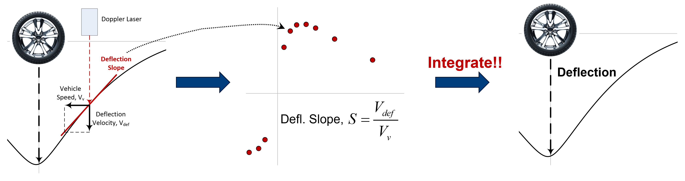{fig-align="center" width="98%" fig-alt="Original Figure 1 from the Analytical Finite Beam Model article"}

::: {.text-center}
*Figure 1. Current TSD practice for continuous pavements.*
:::

However, even on a continuous pavement, integration of deflection slope is a challenge by itself. I discussed some of them in my [TSD-01 article](https://leehyu20.github.io/hyung-s-lee/posts/tsd-four-myths/). But in this article, we will focus on pavements with discontinuities or joints.

Now put a transverse joint between two concrete slabs. The loaded slab deflects more than the unloaded slab, depending on how well the load is transferred across the joint. Unless there is 100% load transfer across the joint and the two slabs on both sides of the joint act more or less like a "single slab", there is usually a discontinuity in deflection right at the joint. In other words, the deflection just to the left of the joint and the deflection just to the right of the joint are different, and there is a sudden "jump" in deflection going from one side of the joint to the other.

[**When there is a discontinuity or a sudden jump in deflection, simply integrating the deflection slopes will not recover the complete deflection profile. The integration may work within each individual slab, but it cannot tell us how much the deflection jumps from one side of the joint to the other. We need additional information for that!**]{.rigid-red}

This is illustrated in Figure 2.

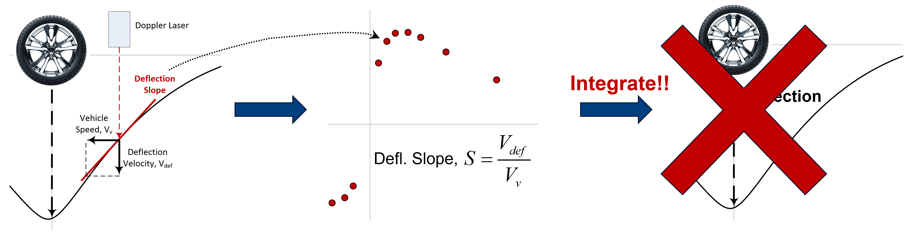{fig-align="center" width="98%" fig-alt="Original Figure 2 from the Analytical Finite Beam Model article"}

::: {.text-center}
*Figure 2. Integration in current TSD practice does not work for joints due to discontinuity.*
:::

Furthermore, an excellent paper by Scavone et al. (2023) discussed this problem and showed why we should not even try to obtain the deflection slope when there is a joint or a discontinuity (Figure 3). Although I will not go through the details here, they showed that the measured deflection velocity includes additional time-dependent contributions, and Equation (1) does not hold true when there is a discontinuity. Instead, the equation should look something like this in the presence of discontinuity.

$$
S = \frac{V_{def}}{V_{v}} + f^{*}(t)
$$ {#eq-rigid-joint-slope}

where $f^{*}(t)$ is the extra term which we cannot obtain from the usual Doppler measurement.

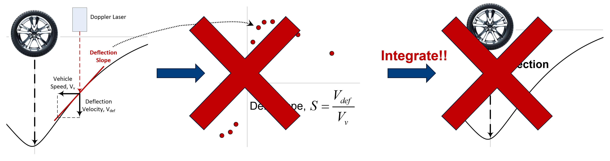{fig-align="center" width="98%" fig-alt="Original Figure 3 from the Analytical Finite Beam Model article"}

::: {.text-center}
*Figure 3. Deflection slope in current TSD practice cannot be obtained for joints due to discontinuity.*
:::

[**This means we should not even be talking about deflection slope when there is a discontinuity. Well... then the only thing we can use is the deflection velocity!**]{.rigid-red}

## 2. Load Transfer Efficiency: A Familiar Quantity with an Unfamiliar Measurement

For jointed concrete pavements, Load Transfer Efficiency (LTE) is a familiar measure of how effectively a load on one slab is transferred to the adjacent slab. A deflection-based definition is the deflection on the unloaded side divided by the deflection on the loaded side, often expressed as a percentage. An example of this concept is shown in Figure 4. If the loaded slab deflects 36 mils while the neighboring unloaded slab deflects 18 mils, the corresponding LTE is 50%.

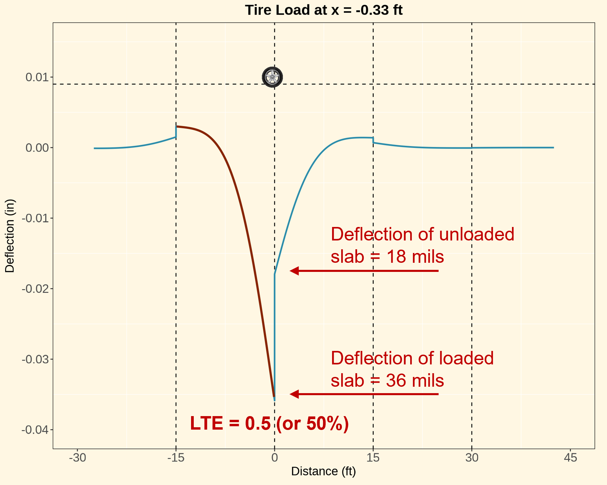{fig-align="center" width="82%" fig-alt="Original Figure 4 from the Analytical Finite Beam Model article"}

::: {.text-center}
*Figure 4. Load Transfer Efficiency (LTE)*
:::

This definition of LTE is easy enough to understand when we have the "deflections" at the joint. But the TSD gives us deflection velocities at fixed offsets from the moving axle, rather than the deflections we want for LTE assessment. As an example, Figure 5 shows real-life TSD data collected from a rigid pavement using a Measure TSD.

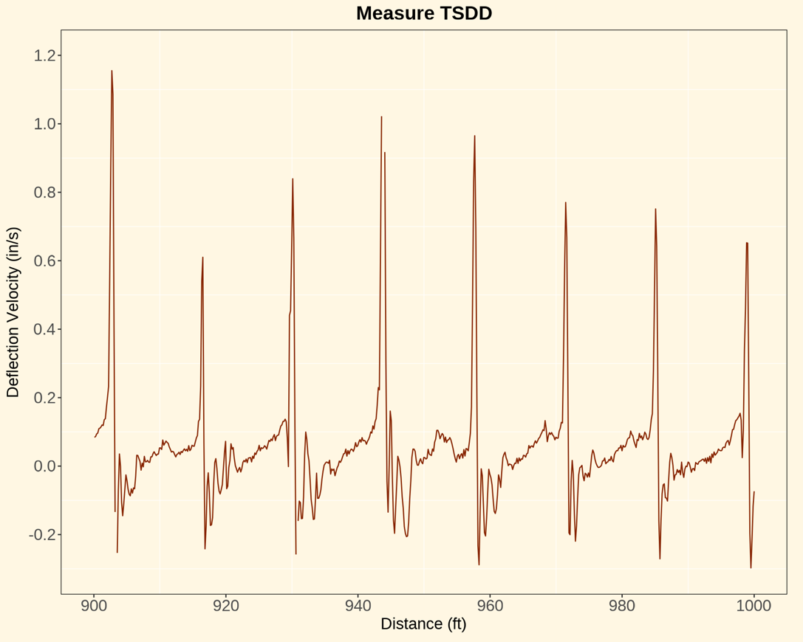{fig-align="center" width="82%" fig-alt="Original Figure 5 from the Analytical Finite Beam Model article"}

::: {.text-center}
*Figure 5. Real TSD data collected from a jointed concrete pavement with Measure TSD.*
:::

We can clearly see the peaks in the TSD signal which correspond to the joint locations. But what does a particular peak velocity mean for LTE? Is a larger peak always evidence of poorer load transfer? These are much harder questions than they first appear.

## 3. Start with the Simplest Possible Pavement: An Infinite Beam

Before introducing any joints, I started with a one-dimensional infinite beam resting on a Winkler foundation. As shown in Figure 6, the concrete pavement is represented by a beam with bending stiffness, and the supporting foundation is represented by independent springs characterized by the modulus of subgrade reaction, or k-value.

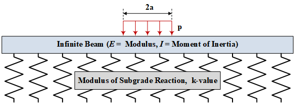{fig-align="center" width="88%" fig-alt="Original Figure 6 from the Analytical Finite Beam Model article"}

::: {.text-center}
*Figure 6. Infinite beam on a Winkler foundation subjected to a distributed wheel load.*
:::

For the above infinite beam, the analytical solution provided Van Cauwelaert (2003), is given as the following.

$$
w = \frac{2p}{\pi k}\int_{0}^{\infty}\frac{\cos\left( \frac{xt}{l} \right)\sin\left( \frac{at}{l} \right)}{t\left( t^{4} + l \right)}dt
$$ {#eq-rigid-infinite-beam}

where *w*(*x*) is the deflection of the infinite beam at distance *x* from the center of the distributed load, and

$$
l = \sqrt[4]{\frac{EI}{k}}
$$ {#eq-rigid-characteristic-length}

Obviously, a real concrete pavement is closer to a two-dimensional plate, not a one-dimensional beam. The foundation is not literally a row of independent springs either. But the benefit of this simplified formulation is that it allows us to investigate the roles of pavement stiffness, thickness, foundation support, and load position without immediately introducing a large numerical model.

Note that for an infinite beam like this one, there are no joints, no discontinuities! In other words, Equation (1) holds true for this pavement and we can calculate and visualize the deflection slope! So, here is an animation I created after implementing the above solution for the infinite beam. It shows how the infinite beam may respond in terms of deflection and deflection slope as the concrete modulus, thickness, and k-value varied over a relatively wide range.



::: {.text-center}
**Animation 1. Sensitivity of modeled deflection and deflection slope to rigid-pavement modulus, thickness, and k-value ([Animation_1_LinkedIn_Post](https://lnkd.in/p/evpCrUdr)).**
:::

This was the easy part. No joints, no discontinuities, and no need to decide how two neighboring slabs communicate with each other. Well... obviously I could not leave it there.

## 4. Introduce One Joint: Two Semi-Infinite Beams

The next step was to incorporate two semi-infinite beams with a single joint in between them, as schematically shown in Figure 7. One beam represents the loaded slab and the other represents the unloaded slab. Both are supported by the same idealized Winkler foundation, but their deflections need not be equal at the joint.

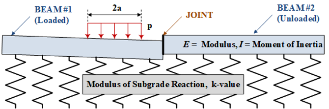{fig-align="center" width="88%" fig-alt="Original Figure 7 from the Analytical Finite Beam Model article"}

::: {.text-center}
*Figure 7. Two semi-infinite beams separated by a joint, with a load applied to the left-hand beam. The joint is represented through prescribed boundary conditions.*
:::

Fortunately for me, Van Cauwelaert (2003) also provided the analytical solution for this case. So, I simply implemented his solution in a code that I could use. I will not present any equations here (because they can be pretty lengthy), but the solution essentially boils down to solving for 4 unknown coefficients from 4 boundary conditions. The necessary boundary conditions at the joint location are:

-   Moment of Beam #1 is zero (*M*~1~ = 0)

-   Moment of Beam #2 is zero (*M*~2~ = 0)

-   Shear force equilibrium (*S*~1~ = *S*~2~)

-   Deflection discontinuity (LTE × *d*~1~ = *d*~2~)

Notice that the **LTE** enters the model as a **prescribed boundary condition**, and it is not a value we predict from the model. This statement needs a little more attention because it is slightly different from other rigid pavement models that we are used to playing around with. Let's take ILLISLAB, for example, which is a two-dimensional Finite Element Method (FEM) developed specifically for analysis of rigid pavements with joints.

Well... what is the major difference when it comes to the boundary conditions or the joints? Unlike the analytical beam solution, ILLISLAB does not specify LTE as a boundary condition. Instead, the amount of load transferred from one slab to the next depends on other specified physical mechanisms, such as dowels (e.g., their length, diameter, modulus, joint opening, etc.) and aggregate interlock.

So, hopefully now you understand that the analytical beam solution is different from conventional FEM solution. Also, there is one additional difference that I want to highlight here. The beam solution provided by Van Cauwelaert (2003) is "ANALYTICAL", meaning the solution is "EXACT" within the simplified beam assumptions without any approximation. FEM, on the other hand, is always an approximation because the entire analysis domain is discretized into smaller elements in which the material behavior (or more specifically, its stiffness and displacement relationship) is established with approximated "shape functions".

Ok. I think that's enough about FEM vs the analytical beam solution I am showing you here. Here is the real question I had: Is the result from the analytical beam solution anywhere close to what we can get from FEM? Figure 8 is where I arrived for a quick answer.

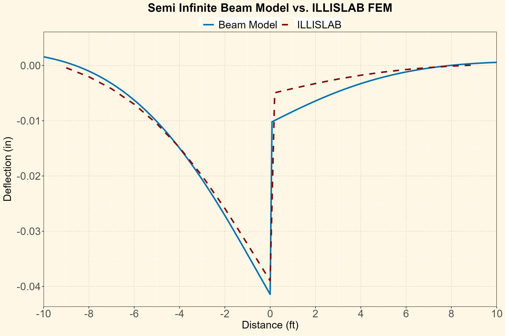{fig-align="center" width="88%" fig-alt="Original Figure 8 from the Analytical Finite Beam Model article"}

::: {.text-center}
*Figure 8. Illustrative comparison of deflection from the semi-infinite beam model and ILLISLAB FEM. These are different idealizations and impose load transfer differently and as such, this comparison should not be taken as a general validation of the beam model* **([Figure 8_LinkedIn_Post](https://lnkd.in/p/eyuHq8mg))***.*
:::

What do you think? I know it is not perfect. But we need to keep in mind that these are two completely different solutions (1D vs. 2D, analytical vs. approximation, different boundary conditions, etc). So, the above figure was not to claim any validation of the models. The only purpose of this was to show that both solutions can show "reasonably similar" results. If you ask me, I personally was pretty happy with what I saw in Figure 8.

## 5. What Happens to Deflection Velocity at the Joint?

Since I was pretty happy with the deflection results I was seeing from the beam model, it was time to move onto simulating the deflection velocity -- again, when there are joints in the pavement, we cannot interpret deflection slopes, so we need to work with deflection velocities.

However, all of the analytical beam solutions were solved while assuming that everything was in static equilibrium. In other words, there is no time history, moving mass dynamics, or speed-dependent material response embedded in the solution. To keep it short... There is no time-dependency in this solution. So, how do we obtain the deflection "velocity" having units of distance over time?

The trick was again provided by Scavone et al. (2023). First, we calculate the deflection, *w*, when the load is placed at a location $x_0$. Then, we move the location of the load slightly (say by $\Delta x$) and calculate the deflection again. Now, if we assume our load is moving at a constant speed of *V*, it is obvious that $\Delta x$ = *V*$\Delta t$. Using this relationship, the deflection velocity is estimated using a methodology similar to estimating the deflection slope, but with respect to time, rather than distance. Mathematically, this is given as the following.

$$
V_{def}\left( x_{0} \right) = \frac{w\left( x_{0} - V\mathrm{\Delta}t \right) - w\left( x_{0} \right)}{\mathrm{\Delta}t}
$$ {#eq-rigid-velocity}

Again, I want to emphasize that the beam solution is based on static equilibrium, and not a fully dynamic, moving load model. So, the above equation is only a crude approximation of the deflection velocity from a static model. Even with that limitation, the numerical results were quite exciting. Figure 9 shows the deflection velocities I estimated for the first time after implementing the above approximation for a joint with different LTE values.

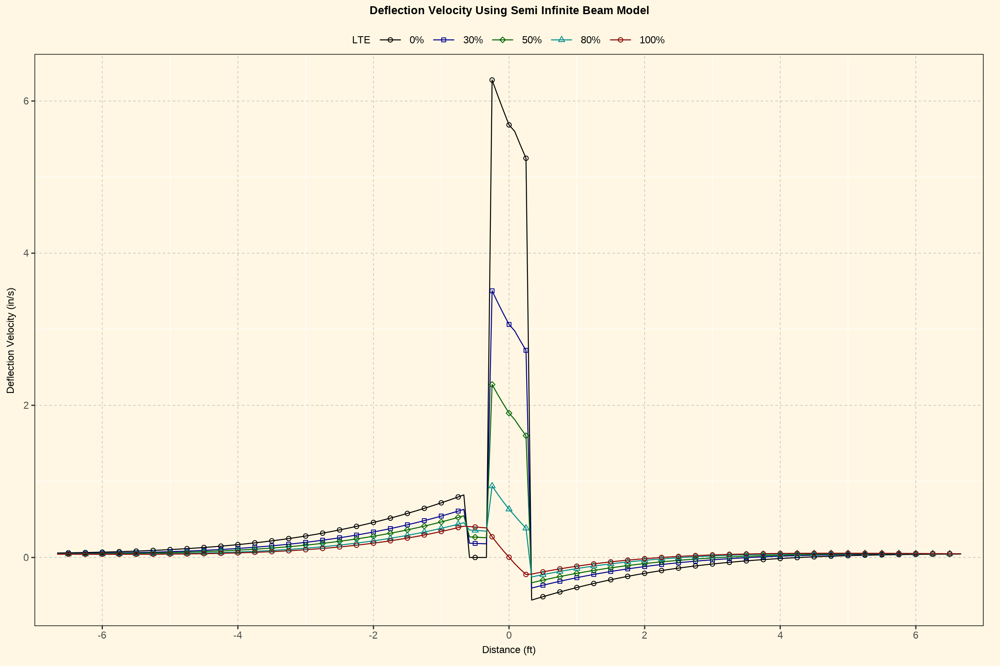{fig-align="center" width="88%" fig-alt="Original Figure 9 from the Analytical Finite Beam Model article"}

::: {.text-center}
*Figure 9. Deflection velocities simulated with analytical beam method for a single joint with varying LTE values* **([Figure 9_LinkedIn_Post](https://lnkd.in/p/eyuHq8mg))***.*
:::

As you see from the above figure, with the joint LTE varying from 0% to 100%, the estimated deflection velocity near the joint changes dramatically, which is in agreement with what Scavone et al. (2023) reported. The shape of the velocity signal shows very "abrupt" changes near the joint which is in agreement with what Scavone et al. (2023) showed and also the real-life data shown in Figure 5.

Awesome! Now, Animation 2 is the first animation I generated using the solution for two semi-infinite beams with a joint in the middle. I tried to show how the jointed concrete pavement deflects under the TSD axle as well as the full deflection velocity that occurs along the length of the simulated pavement. Also shown on the right-hand-side of the animation is what 2 Doppler sensors (5 inches and 60 inches in front of the TSD axle) may "see" as this system travels over the joint.



::: {.text-center}
**Animation 2. Modeled deflection and deflection velocity responses as a tire passes a joint, including illustrative 5-in. and 60-in. Doppler offsets ([Animation_2_LinkedIn_Post](https://lnkd.in/p/e9UKE4js)).**
:::

While I was very happy how this animation turned out, I knew there was still a limitation. A pair of semi-infinite beams is very useful for understanding what happens locally at a single joint, but it does not seem to represent the interior of a series of finite-length slabs very well (because with 2 semi-infinite beams, there is no area that I can call "interior"). So, that is why I decided to go a little beyond what Van Cauwelaert (2003) provided in his textbook, and incorporated 2 or more joints in the model.

## 6. From One Joint to Many: The Analytical Finite Beam Model

Now, let me repeat what I mentioned at the end of the previous section. The two semi-infinite beams seemed to be useful for showing what happens when a TSD crosses a single joint. However, the beam on each side of that joint extends to infinite length (or forever). A real Jointed Concrete Pavement (JCP) clearly does not have that kind of a slab! It has individual slabs with finite lengths, and every slab is connected to its neighbors through joints. So, if I wanted to investigate the response between joints, I needed to introduce some finite-length beams into the analytical formulation.

The idea was simple enough. I kept the two semi-infinite beams at the ends of the pavement system and inserted one or more finite beams between them. Figure 10 shows the simplest version with three beams and two joints. Each beam still follows the same governing beam-on-Winkler-foundation equation. What changes is the number of unknown coefficients and the boundary conditions that have to be satisfied at all the joints. Add another beam, and you get more unknowns. Add another joint, and you get more equations. You can probably imagine how much fun that was to implement manually.

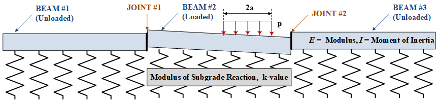{fig-align="center" width="88%" fig-alt="Original Figure 10 from the Analytical Finite Beam Model article"}

::: {.text-center}
*Figure 10. A system with one finite-length beam between two semi-infinite beams.*
:::

At first, I did exactly that. I wrote the equations for two joints, then three joints, and started working toward four. This is where I noticed something interesting. The equations for each beam had the same basic pattern. The boundary conditions at each joint were also being repeated, just at different locations along the pavement. In other words, I was doing the same mathematical bookkeeping over and over again. That's when I said "There had to be a better way"!

Once I recognized that repeating pattern, I developed what I called an **Element Boundary Condition Matrix** for the individual beams. These matrices could then be assembled into one **Global Boundary Condition Matrix**, which I could solve for all of the unknown coefficients. The basic concept is shown in Figure 11. I am deliberately not including all the matrices or their individual terms here. Trust me, they would take up a lot of space and probably make this article a lot less enjoyable to read.

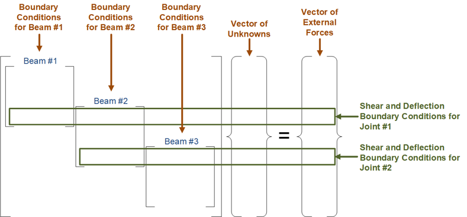{fig-align="center" width="95%" fig-alt="Original Figure 11 from the Analytical Finite Beam Model article"}

::: {.text-center}
*Figure 11. Concept of assembling beam-level boundary-condition equations into a global system.*
:::

If you have worked with FEM, the above process may look fairly familiar. After all, in FEM we assemble the element stiffness matrices into a global stiffness matrix. But as I mentioned earlier, the beam method I am showing here is an exact "analytical method" within the simplified beam assumptions, and hence it uses boundary condition matrices, not stiffness matrices.

In other words, I used the analytical solution to construct the boundary condition matrix for each beam. Then, the individual element boundary condition matrices are assembled to provide the global boundary condition matrix, in a way similar to how Finite Element Method (FEM) assembles the element stiffness matrices for the global stiffness matrix. This is the only reason I am calling this an Analytical Finite Beam Model (for now, in lack of a better name).

The advantage of this approach is that I could easily include multiple slabs, place joints at different longitudinal locations, assign a different Load Transfer Efficiency (LTE) to each joint, and move one or more tire loads along the beam system because within the linear static assumptions, I can easily superimpose the responses from multiple loads.

The best part? Because this is still a one-dimensional analytical-beam formulation, the computations were really fast! And you know what that means, right? It is time for some fun simulations.

## 7. Playing with the Finite Beam Model

As in many of my previous articles, I am never interested in generating just one particular deflection curve and calling it a day. I wanted to see what happened when the joints, slab lengths, and loads changed. So, I started making the animations I am about to show you. The animations were also useful for checking whether the results made physical sense as the load moved from one slab to another.

### 7.1 Four joints with four different LTE values

For the first animation, I modeled four joints located at -15, 0, 15, and 30 ft with LTE values of 25%, 50%, 75%, and 100% from left to right, respectively. Everything else was kept the same so that I could focus on the joint conditions. Animation 3 shows how the deflection and the estimated deflection velocity change as the tire moves across the pavement.



::: {.text-center}
**Animation 3. Deflection and estimated deflection velocity as a tire travels over joints having different LTE values ([Animation_3_LinkedIn_Post](https://lnkd.in/p/ep5cn3G3)).**
:::

Did you see that? The deflection curve is not just one smooth basin anymore. As the load approaches and crosses a joint, the two neighboring slabs respond differently, and the difference depends on the prescribed LTE. With poorer load transfer, the discontinuity in deflection becomes more pronounced. Meanwhile, the estimated deflection-velocity response produces sharp features around the joint locations. Those features also become very different as LTE changes.

But before we get too excited, here is something important. In this simulation I already knew the LTE values at every joint because **I specified them in the model input**. The model then calculated the corresponding response. That is forward simulation. Going in the opposite direction, say from measured Doppler velocity to an unknown LTE, is a completely different problem. For example, could two joints with different properties, slab lengths, or support conditions produce similar velocity peaks? I think that question alone deserves a lot more investigation, and something I might look into in the future.

### 7.2 What if there is more than one tire?

Now, a real TSD does not have just one tire. In fact, one of the lessons from my [TSD-01 article](https://leehyu20.github.io/hyung-s-lee/posts/tsd-four-myths/) for flexible pavements was that the other tires and axles of a vehicle can influence the pavement response. So, I wanted to see if the analytical finite-beam model could also handle more than one load. Fortunately, because the beam model is linear under the assumed conditions, I could calculate the response from each tire separately and then superimpose the results. Here is the resulting animation.



::: {.text-center}
**Animation 4. Multi-tire simulation using the Analytical Finite Beam Model.**
:::

You can see how the deflection profile changes when two loads act at different locations. However, the sharp velocity features are still closely associated with the joints. The combined response is obviously not identical to what we would get from a flexible pavement, due to the joints. The joints with poor LTE would definitely cause less interaction between the two tires. But that does not mean there is no interaction whatsoever. So, the load configuration is another piece of information we cannot simply ignore when interpreting TSD data. Interaction between different tires, slabs, and joints... This is another topic I might look into if I get the chance.

But for now, the only thing I wanted to point out is that the analytical finite beam model can include multiple longitudinal load positions through **linear superposition within the assumed beam model**.

### 7.3 Joints are not always 15 ft apart

Up to this point, the four joints were equally spaced at 15 ft. But nothing says all concrete pavement slabs have to be the same length. So why not change the joint spacing and see what happens? I modified the model to allow the joints to be placed at arbitrary longitudinal locations. I also changed the LTE values while the load traveled along the pavement. Animation 5 shows the resulting deflection and estimated deflection velocity responses.



::: {.text-center}
**Animation 5. Modeled deflection and deflection velocity as the joint spacing and LTE values changed ([Animation_5_LinkedIn_Post](https://lnkd.in/p/exXFieiE)).**
:::

When the distance between joints changes, the length of each slab changes as well. In turn, this affects how the slab bends and how the load is shared with its neighbors. In other words, **joint spacing is not merely the horizontal distance between the peaks in a TSD signal.** It is also part of the structural system that affects how the concrete pavement responds to the load and what the TSD Doppler lasers see in the signal.

I found these animations particularly fun because I could change the joint configuration and immediately see how the simulated response evolved. The beam model remained pretty much the same; all I changed was the geometry and prescribed boundary conditions. Again, I am not claiming that these animations establish a relationship that can be used to directly determine LTE from a measured TSD signal. But they show some of the variables that such an interpretation would have to consider.

### 7.4 One more thing\... what about the outer boundary conditions?

Now let me show you something that bothered me a little as I was working on these simulations. Take a look at Figure 12 below. The left image shows the deflection velocity plot extracted from the first frame of Animation 5. There are 4 joints with all joints assigned to the same LTE of 50%. However, the simulated deflection velocities are slightly different for the 3 joints on the left, and the rightmost joint shows a significantly lower velocity.

[**Four joints with same LTE, four different deflection velocities. What happened here?**]{.rigid-red}

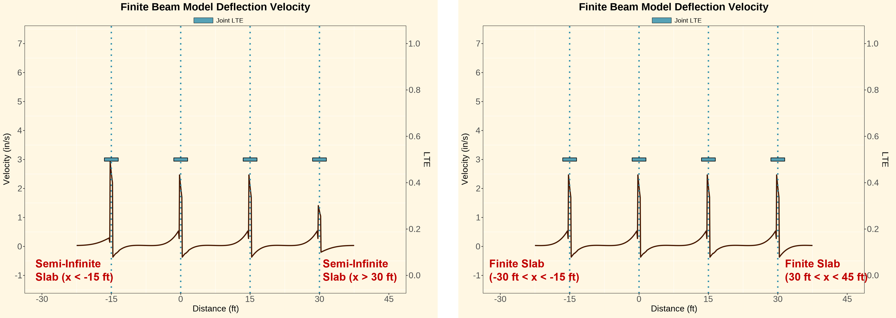{fig-align="center" width="98%" fig-alt="Original Figure 12 from the Analytical Finite Beam Model article"}

::: {.text-center}
*Figure 12. Effect of the assumed outer beam boundaries on the estimated deflection-velocity response. Both examples show four joints with LTE = 50%, but the deflection velocities are different.*
:::

Recall that I had been using semi-infinite beams at the two ends of the system. So, the 2 outer slabs were semi-infinite for the results shown on the left-hand side of Figure 12. In other words, for the joint at -15 ft, the load was moving from a semi-infinite slab to a finite-length slab. On the other hand, the load was moving from a finite-length slab to a semi-infinite slab for the joint at 30 ft. See how different the velocity responses are for these 2 joints? This was a little surprise for me.

So, I started questioning the boundary condition, especially having the semi-infinite beams on both ends of the system. To investigate this, I ran another simulation with two additional finite-length beams. So, another joint was added at -30 ft and at 45 ft (with 50% LTE, just like the other joints), while keeping everything else the same. The deflection velocity results from this extra simulation are shown on the right-hand side of Figure 12. Now, because the load is moving from a finite-length slab to the next finite-length slab, the 4 deflection velocities are more "consistent".

[**So, one lesson learned. The response at a particular joint can depend on neighboring slabs and their boundary conditions, even when its prescribed LTE is unchanged. Boundary conditions are important!**]{.rigid-red}

## 8. What Did I Learn from These Experiments?

When I began this work, my question was simply what the Doppler laser would see when it crossed a concrete pavement joint. Along the way, I ended up developing a model that could include multiple beams and joints, arbitrary joint spacing, different LTE values, and more than one load. That was not exactly where I expected this work to go, but I am glad it did.

The first thing I learned is that we need to be careful about applying the conventional TSD deflection slope concept to a pavement with joints. The Doppler laser measures **deflection velocity**. The common relationship between that velocity and deflection slope requires assumptions that do not necessarily hold at a discontinuity. For jointed pavements, it makes more sense to start with the quantity we actually measure rather than forcing a continuous-pavement relationship onto a discontinuous system.

The second thing is that joint LTE can have a substantial effect on the estimated deflection velocity response. But it is not the only variable. The numerical simulations suggest that slab length, nearby joints, multiple loads, and the assumed boundary conditions can also influence the response. So, a prominent peak near a joint tells us something interesting is happening, but it does not automatically tell us the LTE.

The third thing is perhaps more about modeling than about TSD itself. Sometimes a relatively simple analytical model can help us recognize a complicated physical issue. The model does not have to reproduce every part of a real pavement to be useful for a controlled numerical experiment. However, we do need to be very clear about what we simplified, especially when we start thinking about interpreting real measurements.

## 9. A Few Important Limitations

I should probably emphasize what this model does **not** do before anyone gets the impression that I now have a complete solution for TSD evaluation of jointed concrete pavements. I do not. At least not yet!

First, this is a **one-dimensional beam model**, not a two-dimensional slab or three-dimensional pavement model. A real concrete pavement can distribute a wheel load transversely, and its response is influenced by slab edges, shoulders, dowels, aggregate interlock, and many other details. The Winkler foundation is also an idealization of support beneath the concrete, not a representation of the actual stress and strain fields in the foundation materials.

Second, the analytical beam solution is **static**. The estimated deflection velocity comes from calculating successive static responses as the load position changes, then relating that change to an assumed vehicle speed. I did not model pavement inertia, wave propagation, or a dynamic tire--pavement interaction. I believe this is an appropriate starting point for investigating the response, but it is important not to confuse the result with a fully dynamic simulation.

Third, within the analytical beam model, the LTE is **prescribed** at the joints. The model does not explicitly simulate dowels or aggregate interlock and then predict LTE from their properties. That is why the comparison with ILLISLAB in Figure 8 should be viewed as an illustration of response characteristics rather than a comprehensive validation. The similarities are encouraging, but one comparison is not enough to establish predictive accuracy for field applications.

I may also work on a follow-up article with some future enhancements for the analytical finite beam method. The enhancements may include different concrete moduli, thicknesses, and foundation k-values for individual slabs. Those would certainly make the model more flexible, but they should remain future work until they are actually implemented and tested.

## 10. Closing Thoughts

I started with Van Cauwelaert's solution for an infinite beam and thought this would be a fairly straightforward exercise. Then I introduced a joint, and the deflection was no longer continuous. Then I wanted two joints, three joints, four joints, and different LTE values. Before I knew it, I had an Analytical Finite Beam Model. All because I wanted to know what a TSD Doppler laser would see when it crossed a joint.

What I like the most about this model is that the analytical formulation lets me explore several aspects of the jointed pavement response without building a large FEM model for every experiment. By changing one thing at a time, I could examine how the deflection and the estimated deflection velocity respond to joint LTE, slab length, tire configuration, and boundary conditions.

Am I ready to use this model to backcalculate LTE from TSD data collected on any jointed concrete pavement? **Not yet.** There is still a lot that needs to be investigated. But I think these numerical experiments help explain why the interpretation is not as simple as finding a peak in the measured velocity or integrating a deflection slope. We need to understand the mechanics behind that signal first.

I am sure I will find more things to investigate, and probably more problems to solve, as I continue working with the model. For now, I will keep the name "Analytical Finite Beam Model." It is not the most exciting name in the world, but at least it tells you what the model does.

## References and Source Material

Lee, H.S. "It Is Called an Analytical Finite Beam Model for Now..." Presentation at the 34th FWD User Group meeting. September, 2025.

Scavone, M., Katicha, S. W., Flintsch, G. W., and Amarh, E. (2023). "On the TSD deflection velocity measurements: a revision to the current state of the art and discussion over its applicability for concrete pavement assessment." International Journal of Pavement Engineering, 24(2). DOI: <https://doi.org/10.1080/10298436.2022.2138881>

Van Cauwelaert, F. (2003). Pavement Design and Evaluation: The Required Mathematics and Its Applications. Federation of the Belgian Cement Industry.
