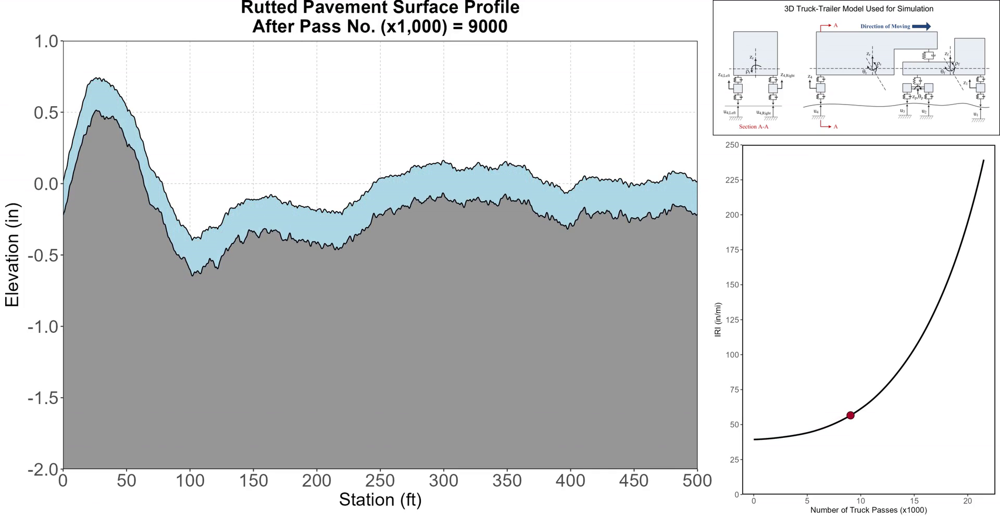
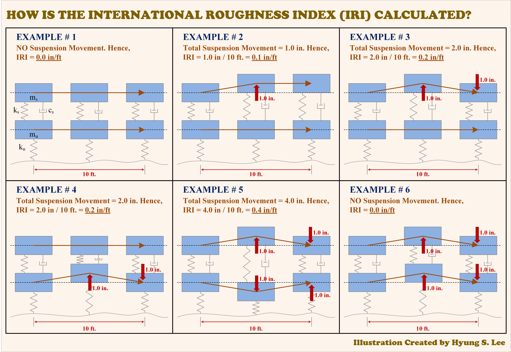

This section focuses on vehicle–pavement interaction, including pavement roughness and ride quality, friction, texture, surface characterization, and the mechanics of pavement-surface measurement methods.

## Articles & Technical Notes

::: {.featured-article}
::: {.featured-article-copy}
::: {.eyebrow}
IRI · IRI-02 · November 5, 2026
:::

### [We Know How to Calculate IRI. But Can We Really Predict It?](../posts/iri-mechanistic-prediction/index.qmd)

Why calculating IRI is mechanistic but predicting future IRI remains challenging—and how four truck simulations connect changing pavement profiles to Golden Car IRI.

[Read IRI-02 →](../posts/iri-mechanistic-prediction/index.qmd){.article-link}
:::

::: {.featured-article-media}
{fig-alt="Mechanistic IRI simulation showing profile deformation and IRI progression"}
:::
:::

::: {.featured-article}
::: {.featured-article-copy}
::: {.eyebrow}
IRI · IRI-01 · October 15, 2026
:::

### [What Exactly Is the International Roughness Index (IRI), and How Is It Calculated?](../posts/iri-what-is-iri/index.qmd)

A technical explanation of how the International Roughness Index is calculated, what accumulated relative suspension movement means, and why six hypothetical quarter-car examples make the concept easier to understand.

[Read IRI-01 →](../posts/iri-what-is-iri/index.qmd){.article-link}
:::

::: {.featured-article-media}
{fig-alt="Six hypothetical quarter-car examples explaining accumulated suspension movement"}
:::
:::
